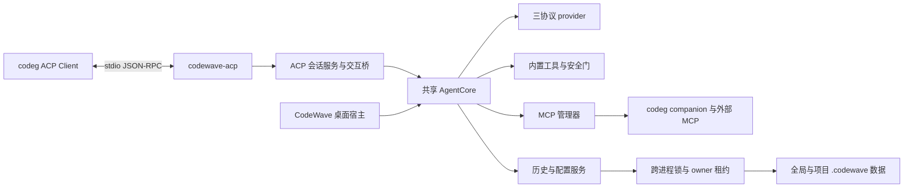

# CodeWave ACP 接入方案

> 状态：待批准，尚未实施。设计日期：2026-10-14。目标是把 CodeWave 的 Rust Agent 作为自定义 Agent 接入 codeg，并保持桌面版的既有行为。本文维护外部协议与宿主适配设计；实施后原位转为接入指南，完成的执行计划留在 Git 历史。

采用独立的 `codewave-acp` 可执行程序，通过 ACP stdio 与 codeg 通信，复用现有 AgentCore、provider、工具、安全门和历史格式。首个可发布版本覆盖多轮对话、工具与审批、四档权限、模型选择、会话恢复、会话级 MCP、双向委派和三平台分发。开发可以分阶段交付，但仅完成握手与文本流不算完成接入。

接入方向是 **codeg 作为 Client，CodeWave 作为 Agent**。注册与基础运行无需 CodeWave 专属 codeg adapter；完整批准语义要求 Client 提供可区分选项和自由文本的回执，当前 codeg companion 需要下文所述的最小兼容扩展。原版回执不满足时安全停止涉及批准的询问，不把基础连接成功视为完整接入。不把 codeg 嵌入 CodeWave；桌面历史原生导入、ACP registry 上架和远程 ACP 服务放在后续范围。

## 需求与验收目标

P0 表示缺少会导致不能正常使用、丢数据或改变授权边界，必须在首个可发布版本完成；P1 允许明确降级；P2 为后续扩展。不新增遥测，以 fixture、联调记录和真机检查衡量结果。

| 编号 | 用户故事 | 优先级 | 验收条件 |
|---|---|---|---|
| AC01 | 在 codeg 中选择 CodeWave 开聊 | P0 | CLI 能注册、安装、探测版本和建立 ACP 会话；不打开桌面窗口，不经过 Tauri 单实例插件 |
| AC02 | 继续使用已经配置的 BYOK | P0 | 读取现有 schema v2、代理与钥匙串引用；不再次向 codeg 提交 Key；无模型或凭据不可用时给出可操作错误 |
| AC03 | 查看回答与实际工具执行 | P0 | 文本、思考、工具进度、结果、diff、计划和真实终态有映射；会话 A 的更新不进入 B |
| AC04 | 从 codeg 选择模型与权限档 | P0 | 支持四档和有效模型；切档不绕过 fence、MCP 策略、G2/G3；恢复不自动恢复历史高权限 |
| AC05 | 回答问题并决定是否批准方案 | P0 | 普通 ask、工具审批与方案批准分别可应答；修订、预览、忽略、取消和断连均不批准；目标档取所选项 |
| AC06 | 与其他 Agent 合作 | P0 | CodeWave 能被委派，也能经 codeg companion MCP 发起委派；临时 MCP 不写入磁盘原生配置、不串会话 |
| AC07 | 在项目或 worktree 中工作 | P0 | 传入 cwd 成为真实工作根；A/B worktree 不串 roots、项目 MCP、技能与产物；命令默认在 ACP cwd 执行 |
| AC08 | 重启后继续同一会话 | P0 | `session/load` 恢复同一 UUID 与 cwd，重播完整可读转录但不重放工具；wire 继续有界读取 |
| AC09 | 同时运行桌面版与多个 ACP 会话 | P0 | 索引、统计、配置与托管数据不丢更新；同一会话只有一个可写 owner；不误恢复其他活进程为 crash |
| AC10 | 随时取消或关闭 codeg | P0 | 取消 LLM、工具、子代理与询问；只清理自己的命令/MCP 进程；有界收尾、保存已产生历史，已生效副作用不重放 |
| AC11 | 在三平台安装 CLI | P0 | Windows/macOS/Linux 已声明架构有独立产物、版本和 SHA-256；CLI 不依赖 WebView 或桌面资源 |
| AC12 | 继续使用技能和 CodeWave 内置子代理 | P1 | 保留技能扫描；桌面专有预览用文本降级；内置子代理和 codeg 跨 Agent 委派分别显示与取消 |
| AC13 | 从 registry 一键发现 CodeWave | P2 | 首版手工注册可用后再申请上架；不阻塞本仓实现与发布 |

用户路径：在 CodeWave 设置模型和凭据 → 安装 CLI → codeg Settings → Agents 添加自定义 Agent → 启用 companion 的询问与委派功能 → 选择目录、模型和权限 → 对话/审批 → 取消或恢复。codeg server/Docker 模式的 CLI、代码目录、配置和钥匙串都位于 **server 所在机器**，不会自动使用桌面机器的数据。

## 设计依据与兼容基线

本地设计依据为 CodeWave checkout `d79f2844dcf96fb2d0b0d1e5ac38f2281489b243`，外部源码依据为 codeg `08baa4188656c5c873e7bb14429230a068658e9c`。实施开始时重新固定 codeg release 与 ACP SDK/schema 版本，fixture 记录版本；这两个提交是设计快照，不代表已完成互操作验收。

codeg 的自定义 Agent 支持 `binary/npx/uvx` 分发、协议转录和委派，无需为 CodeWave 先增加原生历史 parser。[自定义 Agent 指南](https://docs.codeg.app/guide/custom-agents)、[分发源码](https://github.com/spacering-net/codeg/blob/08baa4188656c5c873e7bb14429230a068658e9c/src-tauri/src/acp/custom_registry.rs)。

ACP 基线采用 v1 stdio，使用官方 `agent-client-protocol` Rust SDK；不手写另一套 JSON-RPC dispatcher。具体 crate 版本在依赖验证阶段锁定到 Cargo.lock，不在设计中虚构版本。[Rust SDK](https://agentclientprotocol.com/libraries/rust)、[传输](https://agentclientprotocol.com/protocol/v1/transports)。

现有分层与复用点见 [technical-design](./technical-design.md#1-现行架构与边界)：`AgentCore` 可接收不同 `EventSink`，主循环已使用 tokio；仍需拆开 `lib.rs` 的 Tauri 装配、`build.rs`、宿主模块和凭据依赖。无界面构建不能只新增一个 bin 后继续链接整套桌面框架。

## 架构与取舍



图中的共享指 **复用同一套代码与格式**；桌面和各 ACP 进程各自有 AgentCore，并非跨进程共享一个 Rust 对象。

| 决策 | 采用方案 | 理由与替代方案 |
|---|---|---|
| 运行入口 | 独立 `codewave-acp` bin，官方 SDK Agent trait | stdio/Windows 控制台与桌面入口不同；不复用 Windows GUI subsystem 的 main |
| 核心装配 | `core/bootstrap` 提供无 Tauri 构造，desktop/acp 分别注入宿主服务 | 不复制主循环；Tauri 默认 feature 保持现有开发与打包命令 |
| 数据 | 复用现有全局历史与项目托管数据，补跨进程协调 | 用户无需维护两份模型、技能与会话；ACP 独立库会分裂删除、统计和恢复语义；共享库协调属于首版前置工作 |
| 进程 | 无常驻 broker，stdio 子进程可包含多个会话 | broker 将改变桌面进程模型、启动恢复与安装，首版不引入 |
| 项目 | ACP cwd 绑定一个单目录项目，roots 固定到 cwd | 延续项目定义；worktree 不复用父仓项目目录 |
| 文件与命令执行 | 由 CodeWave 本地工具执行 | 继续使用 pathutil/fence/检查链；不因 Client 提供 fs/terminal 就新增绕过安全门的路径 |
| 普通询问 | 协商到 form 时用 ACP elicitation；当前 codeg custom 路径用 companion ask | 不给未声明能力的 Client 发送表单；不把普通询问伪装成工具许可 |
| 配置 | ACP 只读加载模型配置；批准策略写入仍经统一提交器 | 不暴露配置/凭据编辑 RPC；已有“始终允许”不能绕过提交协调 |
| 持久后台服务 | 首版 ACP 排除 service，与 scheduled_task 一同按宿主能力硬拒绝 | 缩小退出与 retained lease 的首版范围；桌面既有服务仍须纳入跨进程占用保护 |

支持同版本、具备本方案协调能力的桌面与 CLI 并存。旧桌面程序和第三方进程不遵守新增 advisory locks，不能承诺与它们并发写共享数据安全；CLI 检测到 legacy `running.marker` 且无法确认兼容 owner 时拒绝启动并提示先退出/升级桌面。该检查只能覆盖旧桌面先启动，无法阻止 ACP 启动后用户再运行不遵守协议的旧桌面；新桌面和 CLI 需要一起升级，禁止混用旧桌面属于部署限制，不能宣传为已完全拦截旧进程。

## 代码组织与无界面构建

保持一个 Rust package 和现有版本来源，增加默认开启的 `desktop` feature；Tauri 与全部桌面插件设为 optional，并归入该 feature。`codewave` 主 bin 要求 `desktop`；`codewave-acp` 使用控制台入口。build.rs 保留 commit SHA 注入，仅在 desktop feature 开启时执行 tauri_build；tauri-build 本身也须 feature 控制，不能只跳过函数调用。

目标命令如下，实施后以真实构建确认：

```bash
# 工作目录 src-tauri/
cargo build --no-default-features --bin codewave-acp
cargo test --no-default-features --workspace
cargo clippy --no-default-features --all-targets
# 原有 desktop/default 路径继续使用 cargo test --workspace、pnpm tauri …
```

CLI 模式新增或调整的模块：

| 文件或模块 | 职责 |
|---|---|
| `src-tauri/src/bin/codewave-acp.rs` | 参数、version/help、tokio runtime、stdio 与信号入口 |
| `core/bootstrap.rs` | 配置、HTTP client、工具、存储和公共 observer 的装配；明确是否启动 scheduler |
| `core/session_service.rs` | create/load/close/prefs/respond 的共享业务入口；从 IPC 抽出历史/会话逻辑 |
| `core/credentials.rs` | 从 host::keyring 分离无 Tauri 的钥匙串与凭据读取实现；保留原契约 |
| `host/desktop/` 或 gated 现有 host 文件 | IPC、TauriSink、窗口、通知与桌面装配，保持当前导出门面 |
| `acp/server.rs`、`session.rs` | Agent trait、会话绑定、请求身份、能力与 lifecycle |
| `acp/sink.rs`、`projection.rs` | 有界事件队列、ACP 输出、实时/历史共用投影 |
| `acp/interaction.rs`、`content.rs`、`config.rs` | 询问桥、输入内容、模型/权限 selectors |
| `core/process_coordination.rs` | 进程租约、会话 owner、跨进程锁与托管目录生命周期 |
| `core/process_guardian.rs` | 私有进程守护、子进程树启动与异常父进程死亡回收；共享给桌面与 ACP |
| `mcp/` 的 session overlay | ACP 临时配置、连接身份、策略与释放 |

`core/` 不引入 ACP SDK、Tauri 或 codeg 类型；ACP 字段转换留在 `acp/`。提供最小公共 `run_acp` 门面供 bin 调用，不为方便将全部 core 变成 public。桌面 `host/commands/session.rs` 保持薄校验/转调，29 个事件键名不变。可以增可选内部字段和载荷，但同步类型与契约测试。

CLI 的公开参数为 `--version`、`--help` 与 `--stdio`（默认）；进程 guardian 使用非公开内部入口，仅凭继承的私有 IPC handle 启动，命令/env/token 不放入参数或日志。桌面入口同样在进入 Tauri 前识别内部 guardian 启动。首版不提供另一个全局目录开关、不提供凭据命令行参数、不实现 HTTP ACP。日志写 stderr 和现有 logs 内的实例专属文件；stdout 仅输出完整 ACP JSON 行。`--version` 不创建数据、读取 Key、启动 scheduler 或子进程。

## ACP 能力与生命周期

initialize 返回真实版本、Agent 名称与能力。首个可发布版本声明 `loadSession=true`、`promptCapabilities.image=true`、`embeddedContext=true`、`mcpCapabilities.http=true`、`sessionCapabilities.close={}`，不声明 audio、MCP SSE、fork、resume、list、delete、additionalDirectories 或未经实现的自定义能力。stdio MCP 是基线；image 的协议支持不代表当前所选模型支持视觉，发送前另验模型能力。[会话规范](https://agentclientprotocol.com/protocol/v1/session-setup)。

| ACP 方法 | 实现行为 |
|---|---|
| `initialize` | 协议版本与 Client 能力协商；尚无模型也可完成握手，便于展示安装状态 |
| `authenticate` | `authMethods=[]`；未配置模型不是“Client 未登录”，不伪造 OAuth 流程 |
| `session/new` | 校验 cwd、绑定项目、生成 UUID、取得 owner、登记临时 MCP；初始化成功后返回 sessionId/configOptions/modes |
| `session/load` | 只恢复有效 UUID；校验原 cwd、取得 owner；恢复有界 wire，逐段重播可读 display，最后返回当前配置 |
| `session/prompt` | 先校验全部内容和配置，再注册请求→run waiter，启动现有驱动；等待真实终态与输出 flush 后回应一次 |
| `session/cancel` | 只取消当前连接拥有的对应 session/run；空闲时幂等；通知本身不回应 |
| `session/set_mode` | 兼容已有 Client，调用统一 prefs transition；单纯切档不等于方案批准 |
| `session/set_config_option` | 校验 selector/id/value，返回完整 configOptions；mode/model/effort 都使用同一后端事实源 |
| `session/close` | 首版实现并声明 close 能力，取消并保存、释放 MCP/owner；不会删除历史 |
| 未实现方法 | SDK 标准 method-not-found；不返回假成功、不广告对应能力 |

连接状态为 `初始化 → 就绪 → 关闭中 → 已关闭`；会话状态为 `装载中 → 空闲 → 运行中 → 等待交互/运行中 → 收尾 → 空闲`。取消进入收尾；关闭阻断新请求。只有归属本连接的 session 才能 prompt/set/cancel；不能因为另一个进程的 UUID 存在就直接操作其 runtime。

同一 session 在运行或 load replay 期间拒绝第二个 prompt，明确返回 busy；不同 session 可并行。首版不声明原生 steer；codeg 侧发送中的第二个 prompt不会被悄悄解释为 steer或排入下一轮。已有桌面 steer 不变。

新建会话先保存 provisional 元数据，再准备临时 MCP，最后提交 ready 状态并返回 UUID，避免“创建成功但 CLI 重启后 id 不存在”。准备失败/取消时释放连接、waiter 与 owner；尚无用户消息的 provisional 会话元数据按同一 owner 事务清除，不进入普通列表，崩溃后也可识别并回收。自动创建的项目登记可以保留，因为它代表真实目录；失败不会删除用户目录或已有 project.json。已有 `load` 失败只释放本次装载资源，保留原历史和元数据。对 `load` 使用原项目/cwd 快照，不从当前注册表重算；目录缺失或 cwd 不匹配明确失败，不自动换目录。Client 传入的 MCP 在每次 new/load 重新建立，不恢复历史 token/env。

EOF、broken pipe、SIGTERM、Ctrl+C 进入同一关闭路径：停止接纳 → 取消本实例拥有的 run/asks/subs → 等待历史与统计冲刷 → 释放命令/MCP 进程树 → 释放租约。设计总收尾上限 30 秒，内部各阶段共享 deadline，不相加成无限等待；超时记录未完成项并强制清理。此数值是目标预算，需以平台测试验证。`session/cancel` 正常返回原 prompt 的 `cancelled`，EOF 后不尝试向已断开的 stdout 重发。SIGKILL 不执行这个路径，异常子进程回收由进程 guardian 和恢复检查负责。

## 项目与执行目录

创建会话时 canonicalize 绝对 cwd，要求目录存在。以 canonical 路径和平台路径比较规则查找已有单目录项目；命中则保留 id/name。未命中则在项目事务锁下按 basename 创建项目，并保存到 `<cwd>/.codewave/project.json` 与发现索引。可以增 `created_by` 可选元数据区分外部创建，缺省按现有项目处理；不修改父仓目录、不以 Git common-dir 代替 worktree 根。

ACP runtime 固定 `workspace=cwd`、`roots=[cwd]`、`project_dir=cwd/.codewave`、`data_dir=~/.codewave`。首版不自动继承项目的 `allowed_dirs`，不从 Client 声明推导额外根；恢复保持同一快照。桌面仍按既有创建路径继承用户允许目录。后续 additionalDirectories 需要独立定义授权及恢复口径。

增加宿主中立的 `ExecutionDefaults.command_cwd`：Desktop 为现有 project_dir/临时 workspace；ACP 为 workspace。command/service 的缺省目录与对应系统提示同步使用该值，显式 cwd 仍走同一读取边界；所有按项目运行的 post-write-check 继续在代码根。不得调用进程级 `set_current_dir`，以免多会话互相影响。

Plan 档保存方案依旧只属于宿主系统动作，路径位于 `<cwd>/.codewave/tasks/`，使用 UUID 关联防碰撞。技能、记忆、lessons 与磁盘 MCP 继续使用现有全局/项目来源；不增加另一份工作区扫描规则。自动创建项目与计划产物不等于放开普通写工具。

## 配置与凭据

读取现有 providers/models、proxy、安全与技能设置，模型 id 使用 CodeWave 内部条目 UUID，显示名含 provider 与 wire 模型名。不从 codeg 的 provider 配置拿 Key，不新增模型协议。

新 prompt 开始前以公共配置服务读取最新安全快照；正在进行的请求、重试与既有子代理模型快照按原契约保持。codeg 的 session model/effort override 对本会话生效，不修改全局 active_model_id。切换模型时重新生成可用 effort 列表；从 configOptions 和 legacy modes 来的切档都转同一入口，后端批准导致的切档发完整 config_option_update 并同步 current_mode_update。[配置 selectors](https://agentclientprotocol.com/protocol/v1/session-config-options)。

初始权限沿用全局 `ApprovalMode::from_global`，包括用户显式关闭审批后产生 FullAccess；不得因 codeg 委派就自行指定 FullAccess。加载历史后重新计算初始权限；偏好边车只保留模型和思考力度。当前四档的真实限制直接链接 [plan-and-approval](./plan-and-approval.md#1-流程与权限是两套机制)，不把 Plan 或 FullAccess 扩大解释成 OS 沙箱保证。

ACP 不执行启动明文迁移或凭据清理，不提供配置保存 RPC；检测明文/异常引用时返回先在桌面安全保存的指引。系统钥匙串无法回读时安全失败，Linux server 无 Secret Service 不默认为明文或环境变量方案。既有命令/MCP“始终允许”仍可通过公共策略提交服务执行，但不得复制旧配置中的明文。

跨进程配置提交使用同一 OS config transaction lock。当前 boot_id/sequence/page_version/role_versions 是进程内版本，不能直接跨进程比较；公共 snapshot 改用磁盘当前内容的 canonical JSON hash 作为 CAS，page/role/instant 等字段域分别计算 hash，沿用前端 opaque version 类型。所有 snapshot/commit/replay 使用同一字段域投影；锁内重读磁盘并校验调用方 expected hash，冲突要求刷新草稿，不先更新缓存后让旧 Page 全量覆盖。仅写允许策略等 patch 从最新配置合并对应字段；完整 Page 保存必须校验它所覆盖的全部域。操作回执的重复提交仍只回报，不重放过时配置或重复建立凭据。

各进程持有的配置引用通过 **credential lease** 保护：配置读取、pin 引用和 cleanup 在同一事务锁协调；lease 只记录账户 id，不记 secret，并关联活的 instance lease。持有旧模型快照的主/子/title/compact 请求都必须 pin 对应账户；停止使用后 unpin。清理只删当前配置与所有活租约都不引用的账户，失效进程租约经 OS owner 检验后回收。

这层协调必须覆盖 desktop 的 commit/recover 与 ACP 的读取/允许策略提交，不能只保护 CLI。旧配置的前向兼容字段继续 serde default；不引入 schema v1 迁移。详见 [providers-and-network](./providers-and-network.md#2-api-key-与-key-池)。

## 实时输出与终态

新增有界 `AcpSink`，同步 EventSink 方法只向非阻塞队列提交，输出 writer 按会话、run 和子代理映射序列化 ACP 更新。帧和事件进入同一有序投影队列；关键生命周期有明确 barrier，不以各自 spawn 的发送顺序猜测工具先后。

| CodeWave 数据 | ACP 投影 |
|---|---|
| `DeltaText` / `DeltaThinking` | agent_message_chunk / agent_thought_chunk |
| `tool:start` | tool_call，稳定 toolCallId、title、kind、rawInput |
| ToolProgress / `tool:done` | tool_call_update 的进度、真实状态、rawOutput 与可读结果 |
| 编辑前后内容、路径 | diff content 与 locations；不凭普通文本猜 diff |
| `plan:update` | plan entries，映射 pending/in_progress/completed，不伪造优先级 |
| 模型/权限变化 | config_option_update；兼容 current_mode_update |
| usage / context 数据 | 已锁定 SDK 的 usage_update 有对应语义才输出；不把本轮 input+output 当上下文占用，不虚构价格 |
| title / 保存降级 / retry | 支持时用 session_info/notice；否则用简短可读文本，脱敏 |
| 内置 subagent | 主会话的委派工具卡及结果；子过程关联 tool id，首版不承诺 codeg 原生子代理抽屉 |
| render_html / 文档预览 | 可读摘要、真实本地文件引用；不执行 HTML，不声称复刻桌面预览 |

工具实时 call_key 为 batch:index，历史 tool_use.id 为 provider id；provider id 可能跨 step/run/generation 重复，不能直接当全会话 ACP id。为 ACP 工具观察分配独立 UUID，建立 `(session,run,generation,sub,call_key,provider_id) → observation_id` 的关联；provider wire 与模型结果不变。append-only 观察边车把 observation_id 绑定到 checkpoint 后的段号/记录位置/块序，实时与 replay 使用同一 id；历史老记录没有映射时按段位置生成稳定 restored id，不能凭名字猜配。

保留现有 provider-id 工具结果备份契约；ACP 观察需要区分重复 provider id 的结果时，额外存不可变 outcome 引用到会话自有 ACP 观察边车，按该 occurrence 回填，不用覆盖式映射冒充。新观察/导出数据随会话 owner 保存和级联删除，不出网计费、不进入模型历史。

ACP v1 基线不能假设 Client 支持撤回已发文字。遇到 `run:retry` 后明确输出失败尝试边界和重试标记，按 generation 隔离后续帧；已展示的失败尝试不冒充最终答案。不添加未协商的 patch/rewind 扩展。CodeWave 持久化最终转录与 codeg 记录的 ACP 流可能包含不同的失败尝试展示，这是明确的展示边界。

实时队列同时限定消息数与字节数，初始目标 2048 项/8 MiB；可合并相邻同会话同 generation 文本。实时生产达到上限不能丢失审批、工具终态或完成事件：锁存 delivery failure、取消该连接的 run 并报协议交付错误；若 stdout 已阻塞，直接执行有界关闭，不继续生成。历史 replay 使用独立的可取消 async producer，按字节 credit await writer，不用同步 try-send；正常历史不会因为生产过快溢出队列。

单个不可拆 ACP 项目标上限 16 MiB，正常队列允许一条超过 8 MiB 的合法项目独占 credit，直到写完再接纳下一条；队列峰值受单项上限控制。大文本按 chunk 输出。超过单项预算的完整 rawOutput/图片导出到会话自有 `sessions/<id>.acp-assets/` 不可变文件，输出明确的摘要和真实 file resource_link，不删原数据、不冒充内联成功；资产不进入模型历史或普通产物登记。Client 不支持该资源展示时保留可读路径与降级说明。检查原图/完整结果可打开、无新增网络、GC/删除覆盖导出；这些导出是显示投影，不能拿来改写输入文件引用规则。预算需按真实 codeg reader 与图片限制校准。

终态/barrier/取消交互另有小额关键事件预留容量（目标 64 项/256 KiB），与普通队列共享序号、由 writer 按序发送，不抢到大项之前；合法独占大项后紧随 Done 不因普通 credit 暂满就失败。超预留限制仍锁存交付失败，不能无限扩队列。压力测试包含“大项入队 → 立即 Done → 慢 reader”，确保 barrier、内存界限和成功/失败语义一致。

把 typed run completion 提供给共享 session service，避免 ACP 仅监听易丢的 `run:done`。注册 waiter 必须先于 start，run 终态、历史保存完成和输出 flush barrier 都到达后才回应原 prompt：

| 真实结果 | ACP 响应 |
|---|---|
| 正常结束 | end_turn；只代表本轮结束，不代表所有任务已完成 |
| 用户取消 | cancelled |
| 明确输出/step/token 上限 | 与锁定 schema 相符的 max_tokens/max_turn_requests；无对应项则 typed error |
| provider/工具监管/panic/交付错误 | JSON-RPC typed error + 脱敏可读信息，不伪装 end_turn |
| 历史保存降级 | 保留实际运行结果，同时提示未完全保存；新 SaveReport 状态必须纳入 is_clean |

typed completion 的原子封口点决定胜出：core 正式发布终态前接纳的 cancel 使该 run 进入取消；已封口 Done/Error 后的 cancel 是幂等空操作，即使保存或 ACP flush 仍在进行，也不改写既成终态。交付失败独立锁存，Done 后 flush 失败仍不能发送成功响应；EOF 则没有可回应的连接。重复终态、取消与成功竞争只能使同一个 request 完成一次。session/cancel 与 `$/cancel_request` 的处理分别遵循 session 生命周期和 SDK 请求取消，不混用 request id 与 run id。

错误使用固定映射：解析错误 -32700、未知方法 -32601、参数非法 -32602、内部 panic -32603；业务错误统一 -32000，并在 `data.reason` 写稳定枚举，如 `E_SESSION_BUSY/E_PROJECT_BUSY/E_CONFIG_CONFLICT/E_INTERACTION_UNAVAILABLE/E_MCP_PREPARE_FAILED/E_DELIVERY_FAILED`，字段缺省向前兼容。请求级取消为 -32800，session prompt 的正常取消用 stopReason=cancelled。错误 data 只含 id/阶段/脱敏信息，不回显 MCP env/headers、Key 或原始远端错误。

## 工具审批与普通询问

### 工具审批

安全审批继续由现有 safety::approval 和真实 responder 决定。AcpSink/交互服务收到批准请求后发送 `session/request_permission`，绑定 `(connection_id, session_id, run_id, ask_id, sub_id)`，响应回填同一等待者。子代理来源挂父会话展示，实际回应寻址对应 sub runtime。[工具许可规范](https://agentclientprotocol.com/protocol/v1/tool-calls)。

allow_once → `{approved:true,always:false}`；reject_once 或 cancelled → 拒绝；仅原请求允许时提供 allow_always，其名称明确当前持久化粒度。scope 的始终允许仅本 session，command 项目允许与磁盘 MCP server 允许保留其现行语义；临时 MCP 的始终允许仅本连接的该 endpoint/generation。不提供未支持的 reject_always，不按文本 contains("approve") 解析 Client 结果。

原有灾难级 fence、路径边界、逐项/范围/MCP 门仍在执行点判断。Client 的 Auto/FullAccess 可能自动响应工具许可，这是 Client 的授权策略；**方案批准与普通问答不能走这一条可自动确认的通道**。

### 普通 ask 的适配

当前 codeg `build_client_capabilities` 只向 Codex/DeepSeek/Qoder 声明 elicitation.form，自定义 Agent 没有该声明；companion `ask_user_question` 接受 1–4 问、每问 2–4 选项，而 CodeWave 接受 1–5 问、最多 6 选项及开放题。适配必须覆盖这个差异，不能直接原样转发。[codeg 连接源码](https://github.com/spacering-net/codeg/blob/08baa4188656c5c873e7bb14429230a068658e9c/src-tauri/src/acp/connection.rs#L4740)、[question 源码](https://github.com/spacering-net/codeg/blob/08baa4188656c5c873e7bb14429230a068658e9c/src-tauri/src/acp/question.rs#L42)。

交互桥按会话初始化结果选择：

1. Client 显式声明 form → `elicitation/create`，用 flat schema 表达单选、多选与 note；提交后宿主按原 schema 二次验证。[表单规范](https://agentclientprotocol.com/protocol/v1/elicitation)。
2. 当前 codeg custom → 调用本会话注入且通过 schema 检查的 companion `ask_user_question`；题目逐题发送，保留原 id 与稳定 label 映射，最后聚合原 ask 的 selections/note。此调用由宿主驱动，不要求模型学会另一套 ask。
3. 两者都没有 → 立即返回明确 `E_INTERACTION_UNAVAILABLE`，结束当前询问等待并停止本轮继续执行，展示启用 codeg 询问开关/重新连接的指引。下一 prompt 可继续；不把缺能力变成默认批准或永久挂起。

普通题 2–4 选项直接显示；开放题或 1/5/6 个选项先展示完整编号列表，再用“提交答案/跳过本题”的 companion 题收集 Other 文本，解析严格编号集合或普通 note。不截掉选项，不用虚构业务选项填数。单选与多选按照原 single 属性处理；未知/重复/越界编号明确失败，不猜用户意图。题干或描述超出 companion 4096 字符上限时先经 ACP 正文展示全文，再给短指引；完整快照留在 CodeWave ask 中。

companion 的 note 用独立回执字段或额外备注题收集。部分回答、全空、跳过与取消按原 ask 契约回填；所有题和备注处理完毕才一次性 resolve 原 ask，不能先批准再等待备注。断连/取消不以已有部分回答替代完整批准。题序、页数和已答题明确展示，取消后清理全部 waiter。重复 label 加稳定编号前缀后建立反向映射，不截断成相同字符串。

### codeg 批准回执兼容扩展

设计基线的 `QuestionAnsweredItem.selected` 将选项 label 和 Other 文本合并，没有来源标记。用户在 Other 输入恰好相同的批准 label 时，现有协议无法与点击批准区分；nonce、二次同形询问或 contains 匹配都不能消除此歧义。完整接入需要最小的 companion answer v2 扩展：

- 保留 legacy `selected`，新增 `selectedOptions`（只含真实选择的 label/id）与 `freeText`（只含 Other），以及明确的 answer schema version；字段命名以 codeg 实施契约锁定。
- 当前 `QuestionAnswerItem.labels` 在 UI 提交时就已合并选项和 Other；因此需从前端选项状态/Other 输入开始分离为 selectedOptions/freeText，保留 legacy labels兼容，然后由 QuestionAnswer、QuestionOutcome、listener/companion 序列化一路传递。不能在 Rust 收到 labels 后靠字符串推回来源。tools/list 元数据明确广告 v2，返回体也带版本；不能凭二义的旧 selected 或 display name 猜测支持。
- ACP 桥只将 selectedOptions 的精确本次映射转为 selections，将 freeText 放入 note；v2 的 legacy selected 仅用于旧读取者，桥不使用它反推来源。未知、重复、越界、版本/来源字段自相矛盾或不符合原 single/schema 的响应失败关闭；合法多选附带自由备注仍可提交。
- v1 可用于确认为无批准/切档效果的普通询问；凡原 AskTool 判定可能批准、冻结基线或轻量切档的询问都要求 v2 或严格 ACP form，没有则 `E_INTERACTION_UNAVAILABLE`。这个判定从现有 ask 语义抽出同源接口，不在桥里重新猜 option id。

扩展是 codeg 的通用问题回执增强，不是 CodeWave 专属 native adapter。实施涉及 codeg 的问题提交 UI/类型/IPC/web DTO、`acp/question.rs`、委派 listener/companion 输出及兼容测试；视觉和用户流程不改，目标是保持提交来源结构。旧使用者继续读 selected，旧 UI 没有来源字段时不得冒充 v2 回执。需上游接受或用户部署带该兼容扩展的明确版本；本仓不会自动克隆、修改、发布 codeg。若上游暂未提供 v2，只交付“基础连接可用、批准能力受限”的预览版本，AC05 不能记为完整通过，正式首版发布被这项依赖阻断。

交互桥对 companion 的调用是受限的 **宿主交互通道**：只能调用经当前连接注入的 ask 工具、只接受固定问题 schema、没有文件/命令/委派参数，不受普通 MCP 工具批次审批/Plan 排除而形成自举死锁。该例外不把任意名为 ask_user_question 的 MCP 工具变为可信，不开放其他 companion 调用；连接绑定、工具原始 schema 和 endpoint 票据均需匹配。桥专用 ask 从模型 MCP 定义中隐藏，模型继续使用 CodeWave ask；其余 companion 工具保留普通 MCP 策略。

### 计划批准与预览

完整方案先作为 ACP 正文和真实文件引用展示，不塞进 companion 短题干。批准题保留三个原选项，额外加入“查看预览”作为宿主动作；companion 上共四项，映射固定 option id，而非显示文案关键词。批准项描述包含目标权限与风险；用户选中的 mode 经现有 AskTool 再跑 G2/G3、冻结基线并切档。

修订项返回原 revise + note；v2 的 freeText 或 form 的独立 note 即使等于批准 label，也只作备注。预览返回原 `{action:"preview_plan",note:…}`，不带 selections，不批准、不切档、不冻结基线。codeg 无 CodeWave 的隔离 HTML 宿主时，preview 技能输出标为“示意稿 · 未实现”的 Markdown/文件概览，再提供同一方案的批准机会；不得自动启动浏览器或服务来凑齐预览。

原 `approval_shape`、preview-only 三处防提权与 G2/G3 判定保持。仅抽出宿主交互适配和必要公共类型，不在 ACP 层另写宽松批准算法。不能把 `session/set_mode`、“忽略”或 codeg 委派默认视为已批准方案。

## 会话级 MCP 与双向委派

`session/new/load.mcpServers` 转成 **内存 overlay**，不写全局/项目 mcp.json。覆盖顺序为全局 < 项目 < 本连接 overlay；同名临时条目遮蔽磁盘条目，不与其合并 env/headers/trust。重复临时名称、非法 transport/参数在连接前失败；stdio command 与 cwd 使用明确绝对路径，HTTP 按能力接纳，SSE 明确拒绝。

PoolKey/Scope 增 session 来源：连接 id、session id、名称、endpoint/config revision；来源身份用类型表达，不伪造不存在的配置文件路径。即使同名同 endpoint，也不能跨 session 共享携带 token 的临时连接。CallBinding 继续保护 endpoint、schema、策略与代数，晚握手、旧批准和变更票据不得重定向到新 server。

new/load 在返回前完成临时 MCP initialize/tools-list 的有界准备，目标单阶段 30 秒、整组总预算 60 秒，取消立即打断，清理另在关闭共享 deadline 内。Client 传入条目失败则明确报该来源失败并回收已建临时连接；不悄悄忽略注入失败后声称委派可用。磁盘自配 MCP 仍按现行异步 Ready/Error 行为。工具 token 预算计入当前真正可见定义，容量不足明确失败，不无限扩池。

临时条目默认 `read_only=false/always_allow=false`，不从 tool annotations 推断信任。allow_always 写入该临时连接的 policy generation，不落盘、不在 load 时复用。磁盘条目始终允许仍回原来源提交；提交/reconcile 必须保留同会话 overlay，不能一次保存就把 companion 丢掉。[MCP 与技能](./mcp-and-skills.md#3-工具集合调用与审批)。

CodeWave 被委派时是一个正常 ACP 主会话，使用收到的 cwd/模型/档位；它的内置 subagent 沿用根权限在 step 边界重建。CodeWave 主动委派使用普通 companion `delegate_to_agent`，按 codeg 开关与工具 schema 决定可用性；Plan 仍排除这类普通 MCP 调用。不得自动打开委派或设置 always_allow。

连接级委派深度/预算遵守 companion 提供的可信约束；不在 CodeWave 层自行重新注入 token、绕开 codeg 的层数检查或把跨 Agent 会话伪装为内置 sub_id。关闭只回收本连接的临时 MCP 与自己启动的进程；不会手工杀 codeg 或另一 Agent。

## 跨进程数据协调

现有 SessionStore 的 save/index/artifacts 锁、config coordinator、MCP config 提交锁与 stats RMW 都是进程内保护。单纯 atomic rename 不能保护多个进程的读改写。本方案在共享业务入口补 OS advisory lock，并保留原进程内锁；阻塞磁盘锁在 blocking pool 执行，不跨锁等待模型、用户或网络。

使用 Rust 1.98 可用的文件锁 API封装 Unix/Windows 实现，验证可取消的 try-lock 重试；依赖确认若平台能力不足再选择受维护的专用 crate。锁文件位于 `~/.codewave/locks/`，以 canonical 资源身份 hash 命名，稳定文件不删除、不 rename；进程崩溃由 OS 释放锁，不靠 PID 或锁文件是否存在猜存活。网络文件系统不在首版支持范围。

| 资源 | 持有期与锁内操作 |
|---|---|
| instance owner | 进程寿命 exclusive lease；manifest 只记 instance UUID、版本、PID、来源及持有会话，不记密钥 |
| session owner | create/load 至 close 的 exclusive lease；包含所有主/子历史、blob、todos、prefs、artifact 与完整结果的写者归属 |
| sessions/index | 短 exclusive tx：重读最新 index → merge → atomic write；不能拿本进程缓存覆盖他人的条目 |
| config transaction | 短 exclusive tx：配置/journal 版本、credential pin、commit/recover/GC；同一锁下重读磁盘 |
| MCP 配置文件 | 原 canonical source 短 exclusive tx：重读版本、策略补丁与文件提交；和进程内 CONFIG_COMMIT 顺序统一 |
| 项目注册/生命周期 | 项目 create/save/delete 与新会话 owner 登记同一协调入口；项目跨进程占用阻断删除 |
| stats 日期文件 | 日期级短 exclusive tx：读取最新桶 → 合并 pending → 原子写；flush 失败保留 pending，不先 clear |
| workspace run | canonical 根级 exclusive run lease：同一根两个活 run 不并行执行；不同 worktree 可以并行，返回 busy 而非等用户审批期间阻塞 |

workspace 的物理 OS 锁由该实例 guardian **唯一持有**，共享 session service 在 start_chat 之前取得逻辑 LeaseRef，再以已有运行守卫确认启动；主进程、子代理和各子树不各自 open/重复 exclusive-lock 同一文件。guardian 将同一 owner_root_id 的主 run、内置子 run、命令和调用 cleanup 映射为逻辑引用；不能在 start_gate 内 await guardian，启动失败必须释放尚未使用的 ref。

workspace lease 从根 run 启动持到全部内置子代理、命令副作用和主 run 收尾；同树子代理继承，不二次申请物理锁。首版 ACP 排除 service；兼容桌面的持久 service 则在会话关闭或最后一个服务停止前继续计入占用。同一 owner_root_id 的后续 run 复用 retained lease 与引用计数，不能被自己的服务 busy；其他 root owner 仍拒绝。释放条件是该根主/子 run 与执行/cleanup/服务引用均为零，不能以全部常驻登记进程结束为条件；停止最后一个服务仅在无活 run 时释放。此锁只协调 CodeWave 实例，不承诺协调 codeg 的其他 Agent、外部编辑器或未识别的 shell 副作用。

仅靠主进程的 OS 锁不能覆盖 SIGKILL 后继续运行的 Unix 子进程。为被管理的 shell/MCP（以及桌面 service）使用独立的 Rust process guardian：私有继承管道是主进程唯一 heartbeat，非 guardian 子进程不能继承其写端；guardian 负责创建/登记进程树、持有工作根执行租约并转接必要 stdio，启动确认后才允许执行。它不运行 Agent 或持久任务，属于进程回收辅助。Windows 使用 kill-on-close Job Object；Unix 使用登记的进程组，父管道 EOF 后终止并 wait/reap，树退出前不释放工作根。

MCP 的常驻连接与工具调用占用分开：初始化登记完成后只持 instance registration，空闲 MCP 进程不持 workspace run ref；正常工具调用结束即释放该调用 ref，cancel 后保留 cleanup ref 到确认该调用停止或相关树回收。不得为已有空闲 companion 永久占用工作根。MCP 启动/后台自行写文件属于外部进程信任边界，不能以空闲标记证明其只读；对 CodeWave 管理的请求、命令和已知残留树提供协调，对 server 自主行为不作 OS 沙箱保证。

子树 manifest 只记录可验证的 OS 身份（instance、PID/PGID、启动身份/epoch、根、状态），无命令密钥或 env。guardian 也被强杀或系统崩溃时，下一 run/项目删除先在生命周期锁内认领 orphan recovery generation，然后释放锁完成核验和回收，再锁内确认状态；只有证明原树已退出才允许新 owner。身份已复用或无法可靠验证时返回 busy/需要人工处理，不杀无关进程，也不把锁已释放视为进程树已死亡。守护、manifest 和启动确认的 race 在三平台 fixture 中验证，是 S2 前置而非靠正常退出测试推断。

锁序明确为：生命周期协调 → owner 获取（仅 try），随后释放短生命周期锁；保存为 owner 已持有 → 现有进程内 save_lock → 对应磁盘事务锁 → 进程内 index_lock，同一次保存不得反向从 index 进入 save。config/MCP/stats 与 history tx 不相互嵌套，跨资源先取得快照再分别提交。短锁内不等待 run、MCP、网络、guardian 或用户；资源 try-lock busy 立即返回，短事务阻塞等待目标上限 5 秒并可取消，返回稳定 E_STORAGE_BUSY。实现阶段为每个入口画出锁序，针对 cancel、panic、delete 与 close 做死锁测试。

新的实例恢复不调用当前“扫描所有 running 条目”的旧全局 crash 逻辑。SessionMeta 增 serde-default 的 origin/run_owner；逐项在生命周期锁内检验 owner lease，只有 owner 已失效才标 crash。旧 desktop marker 仅在确认没有兼容活 owner 后走既有恢复；ACP 不创建/删除旧 marker，使用 `instances/<uuid>/` 的自有记录。完成历史 checkpoint 后同步对应 owner 状态，收尾只更新自己的 running 标记。

session/load 或 desktop 打开被其他实例拥有的会话返回 `E_SESSION_BUSY`，不会偷取 lease；可通过只读历史接口查看磁盘快照，不建立第二个可写 runtime。其他实例结束后释放 owner，即可重新打开。桌面恢复多个 Tab、关闭 Tab 与僵尸检查必须一并改为共享 session service，防止仅给 ACP 加锁却让桌面绕过。

项目删除采用两阶段事务：生命周期锁内检查外部 owner/登记进程树，有外部占用则在任何删除前返回 `E_PROJECT_BUSY`；否则登记 deleting generation，阻止新 owner，立即释放锁。锁外取消本进程会话、等待保存/guardian 回收；再取生命周期锁核验同一 generation、owner 与进程树已空，才级联删除托管数据。清理失败不删除剩余数据，记录可恢复阶段；重启根据 tombstone 继续确认或在无删除发生时解除冻结。用户代码目录永不动，不能持 lifecycle 锁等待会再次申请它的收尾保存。未注册的活会话、孤立产物与 owner 检查也按 canonical 项目根覆盖，不只凭可裁剪的 index。

这里的进程树已空是指该项目的执行/cleanup/服务引用已清理、该项目 MCP session binding 已释放；不是结束整个实例所有 resident MCP。仍由其它项目使用的全局 MCP peer保留，其连接/票据/进程身份不得因删除此项目改变。

LRU/保留期清理不淘汰活 owner，会话删除/旧格式清理/blob GC 要求 session owner 或短维护 lease；按既有可读判据与全部保留段引用并集处理。清理无法取得租约则跳过并报告，不强删锁/数据。

当前 write_roots 包含全局 .codewave；桌面共用写路径已加入[宿主内部状态保护](./tools-and-safety.md#宿主内部状态写保护)，普通 create/edit/delete/文档工具与已识别命令写目标不能直接修改 config/journal、index/histories/sidecars、协调/信任树、stats 和项目配置/调度状态，业务服务经对应入口操作。ACP 必须复用这一层，不能只保护新增锁模块；这项前置保护不代表本方案的 owner、guardian 或跨进程事务已经实施。已允许编辑的 global memories/skills 与项目 memory/lessons 仍须补 canonical 文件资源短事务协调，读取编辑基线后保存还要 CAS，避免两个不同 cwd 的会话丢更新。

shell/MCP 的任意外部副作用仍受既有 fence/信任边界，advisory locks 不是 OS 沙箱。对已识别的内部状态写目标须在 command/service fence 加明确拒绝，不能以 FullAccess 放过 locks 删除；对解释器等未识别写不能声称完备保护。不识别/不合作的进程属于既有非沙箱边界，方案不以未知命令作为修改宿主事务文件的正当入口。

桌面 UI 只需最小支持：在共享会话列表体现可选来源/占用提示，读历史/继续对话分开，busy/delete conflict 展示明确消息。不增加 ACP 控制台、另一个项目入口或设置大页，界面仍使用现有 antd/i18n/token。

## 历史恢复与内容转换

实时和 replay 复用同一工具/消息投影，避免 codeg 中实时工具卡与恢复卡结构不同。恢复 display 逐段读取全部可读转录，坏行/坏段按现有容错提示；wire 仍从尾部有界重建，绝不为了 ACP load 用全量 display 回填模型上下文。ACP 的全量历史 replay 本身随历史体积增长，这是协议成本；它不改变本地 wire 装载的有界契约。

load replay 不执行工具、不重建旧 ask waiter、不恢复高权限、不重复统计计费。原已回答 ask 作为历史工具结果显示；未完成审批显示“原请求已失效”，下一 run 重新决策。工具 sidecar 继续以 provider tool_use.id 读取，图片经现有 Persisted DTO/blob 还原，子 owner 继续 `<父>__<子>`。不改 core::types::Content 或三协议消息字节规则。[历史契约](./sessions-and-projects.md#3-历史存储只追加不因上下文预算删转录)。

load replay 可被连接关闭/请求取消打断，释放临时连接和 owner；部分 replay 不能报成功，后续加载从原数据重来。主/子配对和 compaction 显示保持现有语义；SDK/Client 未协商 compaction 更新时输出可读边界，不伪造支持。

输入先完整校验后才登记用户消息：text 保序；image 校验 MIME/base64/体积与有效模型 vision；embedded text/resource 保留来源和内容，作为显式用户上下文，不覆盖磁盘文件。resource_link 的本地 file URI 解析成真实路径引用并走 roots；HTTP URI 仅作为链接文本，不自动下载；非图片二进制指向 read_document。拒绝 audio 和不支持类型，不静默丢附件。单消息总量、图片和协议行上限在 schema fixture 中固定，初始计划 16 MiB 单消息，实施前按现有图片限制和 codeg 输入上限核对取更小值。

codeg 有自己的 ACP transcript，本仓保留 CodeWave 历史，两者是各自的本地副本。删除 CodeWave 会话不等于删除 codeg 转录，反向亦然；首版不跨应用自动删数据，也不实现桌面旧历史的 codeg 扫描 parser。

## 工具与宿主能力

| 能力 | ACP 首版策略 |
|---|---|
| read/list/grep/edit/create/delete/command、Office/PDF、网络、calculate | 复用当前实现与权限；不改变 SSRF/fence/文档保真边界 |
| plan/ask/skill/subagent/wait/suggest | 复用；询问交互经上述桥，内置子代理过程提供可读关联 |
| service / scheduled_task | 首版 ACP schema 与 dispatch 均排除，不启动全局 supervisor；持续服务/自动化使用 codeg 的相应能力，后续另定义 ACP service 的租约和恢复 |
| render_html / preview | 返回内容与概览；不在 ACP 进程执行 UI 或启动 web server，不宣称 Client 支持 CodeWave widget |
| updater/托盘/桌面通知/openers | 不装配到 CLI；失败指引为文本，codeg 自己负责 UI |

排除 service/scheduled_task 属于宿主能力，必须同步系统提示和执行拒绝，不能只从 schema 隐藏。技能仍按全局/项目/兼容目录优先级扫描；codeg 自定义 Agent 配置可声明 shared `.agents/skills` 和 dedicated `~/.codewave/skills`。CLI 不因 codeg 设置页不存在原生 MCP 编辑器就改变已有磁盘配置。[技能来源](./mcp-and-skills.md#4-技能发现覆盖与管理)。

## 分发与版本策略

CLI 与桌面使用 Cargo package 同一版本，不新增独立版本号来源；现有 bump 仍四处同步。首批目标明确为 darwin-aarch64、darwin-x86_64、linux-x86_64、windows-x86_64；Linux ARM64 和 Windows ARM64 后续另做系统钥匙串/工具链验证，不在 distribution 填入没有产物的平台。

Release 新增 `codewave-acp-<version>-<platform>.tar.gz`（Windows zip）、SHA256SUMS 和 `acp-distribution.json`。macOS CLI 自身签名与公证验证，不能以 `.app` 已签名代替；Linux 要说明动态依赖/libc baseline，Windows 检查 Secret Service/GTK 等 Unix 依赖没有误链入。压缩包根目录只有可执行文件和必要许可证/说明，不依赖 UI dist 或桌面资源。

手工注册 distribution 的形状如下，**示例占位符不能直接安装**：

```json
{
  "binary": {
    "darwin-aarch64": {
      "archive": "<同版本 Release 的真实 CLI 压缩包 URL>",
      "cmd": "./codewave-acp",
      "args": ["--stdio"],
      "sha256": "<真实 SHA-256>"
    }
  }
}
```

生成脚本从实际产物和版本生成全部已发布平台条目，测试 archive/cmd/hash 一致且 cmd 位于 archive 内；避免手工复制导致版本漂移。registry id 建议 `codewave`，显示名 `CodeWave`，预检命令 `codewave-acp --version`，MCP 支持保持开启。codeg 询问/委派开关必须按用户意愿设置，不自动改它的配置。

不承诺最低 codeg 版本号直至固定 release 联调；按 custom Agents、companion ask、configOptions 和 session/load 的实测功能矩阵选择并记录最低版本。老 Client 可用 modes，不能用缺能力作为安全降级借口。官方 SDK、codeg 或 schema 升级需要重跑互操作 fixture。

发布复用现有 draft/显式 publish/tag 授权流程，CLI hash 分发与 Tauri updater 签名是不同链路，不把 CLI 添加进 latest.json 的桌面更新平台。当前设计不 bump、打包、创建 Release 或上架 registry。

## 文件级实施清单

实施分支建议 `feat/acp-integration`（基线为实施时 HEAD）。批准仅预授权创建/切换这一分支，commit/push/merge/tag/publish 仍按 [AGENTS](../AGENTS.md) 与 [release](./release.md) 的单独授权。本轮只编写方案，不建立分支。

| 阶段 | 文件范围 | 完成条件 |
|---|---|---|
| S1 构建与装配 | Cargo.toml/Cargo.lock、build.rs、lib.rs/main.rs、bin/codewave-acp、core/bootstrap、core/credentials、host/keyring、host/commands/session | headless 不构建/链接 Tauri及平台通知依赖；desktop 默认路径不变；迁移 context/title/quota/drive 的凭据调用；共享 session 服务形成 |
| S2 数据协调 | core/process_coordination/process_guardian、sessions/store/interrupt/cleanup/image_blobs、projects、stats、config_commit、mcp/service、pathutil/fence、desktop 会话 IPC与少量 UI 类型/提示 | 多进程 owner、RMW/CAS、内部状态防写、GC、credential lease、guardian/删除/marker 测试通过；未通过前 CLI 不进入共享真实数据联调 |
| S3 ACP 对话 | acp/server/session/content/config/sink/projection、agent/runtime/drive、batch 观察字段 | new/prompt/cancel/close、模型/权限、真实终态、backpressure、工具 id 与内容映射闭环 |
| S4 询问与 MCP | acp/interaction、tools/ask 的类型/宿主接口、safety/approval responder、mcp/config/manager/service/tools | overlay、普通 ask、三项批准与预览、缺能力停止、所有拒绝/取消路径通过 |
| S5 恢复与工具 | session_service、历史 projection/观察边车、subagent/command、prompt/registry 的宿主能力 | load replay/backpressure、大项投影、稳定工具观察 ID、CLI cwd、service/scheduled_task 硬排除通过 |
| S6 验证与交付 | ACP fixture/tests、scripts/pre-pr 与测试、CI lint/test/release、产物生成脚本与测试 | default/headless 两种构建、三平台协议/多进程测试、真实 codeg 联调、CLI 校验分发通过 |
| S7 文档与审查 | 本主题及 architecture/providers/MCP/sessions/runtime/testing/release/settings 受影响章节、README/AGENTS/index | code-reviewer 七维审查；严重问题修复；将计划原位转现行指南，仅保留未完成平台验收 |

依赖顺序 S1 → S2 → S3 → S4 → S5 → S6 → S7；S3 可在隔离 fixture 数据上提前探索，不能绕过 S2 对共享真实数据的门。源码模块、构建/锁文件、CI 与跨层类型由主代理集中修改；其余任务包按明确文件所有权拆分。工作量集中在共享存储协调与交互兼容，不能按“新增一个协议文件”估算。

外部依赖任务 U1 为 codeg companion answer v2：在 codeg 仓库的 `components/chat/ask-question-card.tsx`、`lib/ask-question.ts`、问题 IPC/web DTO、`acp/question.rs`、`acp/delegation/listener.rs`、companion tool 输出/schema 与相关 tests，从前端状态到工具回执保留选项/freeText 来源并增加版本广告；U1 可与 S1–S3 并行，但阻断 S4 的完整批准联调和正式发布。该仓代码变更、分支和贡献 PR 另按用户授权执行，本方案批准不授权推送其它仓库。S1 还须区分 `mac-notification-sys/tauri-winrt-notification` 的 desktop gating 与 provider 使用的 Windows winreg，不能误删系统代理依赖。

待执行 todos 与阶段表一一对应：

- [ ] S1 完成 headless 构建、共享装配及 desktop 回归。
- [ ] S2 完成共享数据/guardian/内部状态保护，并通过多进程与崩溃序列验证。
- [ ] S3 完成 ACP 会话、内容、配置和终态协议测试。
- [ ] U1 固定具有来源回执的 codeg 版本，或明确保留受限预览版状态。
- [ ] S4 完成询问、批准、预览、MCP overlay 与双向委派联调。
- [ ] S5 完成历史重播、稳定工具观察、图片与大项投影、工具宿主差异验证。
- [ ] S6 完成本地完整门禁、三平台 CI/CLI 分发与真机人工清单。
- [ ] S7 完成 code-reviewer 审查，修复严重问题并更新长期契约与未完成验收。

## 验证计划

方案阶段只做文档核对。以下为实施必须执行的验证，不代表本次已通过。

| 级别 | 核心场景 |
|---|---|
| 单元/契约 | selectors、各类内容、工具 id、mode/approve/revise/preview 映射、capability omissions、scope/trust/overlay 票据、serde default、typed completion |
| stdio 集成 | 真实 CLI 进程握手、多轮、两个会话并行、busy、cancel 与 done 竞争、EOF、broken pipe、slow reader、超长/畸形 JSON、panic；stdout 零非协议行 |
| MCP 集成 | 真实 Node stdio/HTTP fixture；不同 token 同名 server、失败回收、晚握手、临时 always、磁盘保存保留 overlay、Plan 内仅宿主 ask 可调用 |
| 多进程 | 桌面核心 fixture + 至少两 ACP 进程；同 index/stats/config/项目并发更新；同会话 owner 拒绝；SIGKILL 后恢复；其他活 owner 不误报 crash |
| 历史 | 分段 append、前缀 fallback 只新增、残行容错、compaction wire 对拍、超过多段的 replay、长工具 sidecar、图片 GC、取消 replay、重播不执行/计费 |
| 权限 | 四档工具集与 dispatch 同源；灾难级、scope denied、G2/G3、显式 FullAccess、preview_approve/混合 action/旧 label 防提权、子代理实时跟档 |
| 服务/任务 | 同根 run busy、不同 worktree 并行、桌面 service retained owner 可复用；command/MCP parent-death 回收；ACP service/scheduled_task 无法 dispatch、不启第二 scheduler |
| 构建/打包 | Rust 1.98 MSRV；default + no-default-features 三平台；CLI clean install 无 WebView；archive paths/版本/hash/license；macOS 签名、公证、钥匙串真机 |

实施后完整运行 `pnpm prepr`，新增 headless 门禁同步脚本与 workflow 契约测试。当前检查不能删除，clippy 软失败仍须明示；新增 warning 当场处理。报告每个命令的目录、平台、退出码、失败/跳过项；三平台 CI 与当前平台本地结果分开。

以下序列 fixture 必须有固定断言，不能只用单次成功调用关闭 AC：

| 序列 | 预期结果 |
|---|---|
| companion v1/v2；Other 输入精确批准 label；重复 label | v1 不承载任何可切档/批准 ask；v2 freeText 不生成选择；重复 label 稳定编号消歧 |
| 五问/六选项/长中文 → 部分回答 → 取消；选择批准 → 收备注 → 取消 | 无截题/截选项；原 id 保留；聚合最多一次；取消不批准、不冻结、不切档 |
| 预览 → 再询问 → 修订 → 再批准 | 预览保持基线；本次真实选择才批准，旧 responder 不能回答后续 ask |
| core Done 封口 → 保存阻塞 → cancel；重复 Done；迟到 permission | cancel 不改已封口终态；flush 失败另报交付错误；旧回答不影响下一 run |
| new 中第一个 MCP 成功、第二个超时 → 重试 | provisional 会话/owner/waiter/临时进程回收；已有项目/用户文件保留；后续创建成功 |
| ACP owner → desktop 只读查看/继续 busy → close → desktop 恢复 | 全程一个写 owner；只读不抢 lease；释放后正常继续 |
| desktop 服务 → 同 owner 下一轮 → 其他 owner busy → stop；主进程 SIGKILL → 新 run/删除 | 自身复用 lease；他者被拒；guardian 清树前不得新写/删除；无法证明身份时 busy |
| 常驻空闲 companion → A prompt → 内置 sub → 完成 → B 同根 prompt | 仅 guardian 持物理锁；sub 重用逻辑 ref；A 收尾释放 run/call ref，idle companion 不阻塞 B |
| config Page snapshot → ACP AllowCommand → Page 保存；旧模型账户 pin → 轮换 → GC | stale Page 明确冲突不覆盖允许策略；所有活主/子/title/compact 引用结束后才回收旧账户 |
| history/blob/index/stats 事务边界 SIGKILL | 不误判其他 owner；完整已提交记录保留，未提交状态可恢复；无早删 blob 或重复累加 |
| 多段 replay、四张 5 MiB 图片、超大 sidecar → 取消 → 再 load | await 背压不因生产速度失败；大项导出可读；无工具重放/计费；wire 对拍不变 |
| 合法独占大项 → 立即 Done → 慢 reader；删除 A 项目时 B 使用 global MCP | 关键预留不溢出或乱序，Done 等 flush；只释放 A binding，不结束 B 的共享 peer |
| 不同 step/run/generation/sub 重复 provider id → checkpoint → load | 独立 observation_id 不碰撞；原 occurrence 的结果正确；未改 provider wire id |
| symlink/大小写根别名 → 竞争；不同 worktree | 同一 canonical 根互斥，不同 worktree 并行，不能以别名绕过 |
| create/edit/delete/文档写内部锁、其祖先目录或符号链接；global skill 同基线编辑 | 拒绝绕过宿主状态保护；global CAS 冲突可见；锁 inode 不被替换 |
| 旧桌面先启动/后启动；guardian 也被强杀；deleting tombstone 中崩溃 | 前者拒绝可检测；后者明确部署限制；未确认树/删除阶段不误放行，不杀身份复用的无关进程 |

stats 的“提交后、pending 清理前”崩溃窗口须以批次 id/磁盘回执去重，或证明 pending 仅内存且恢复不重放；若持久化 pending，不得仅凭累加桶实现重试。文档与脚本更新同时校正 README 旧隐私描述，以现行统一凭据提交器为准，不沿用“先写明文再迁移”。

真实 codeg 人工清单：

1. 手工注册、Install/preflight、模型和四档可见；CLI 启动无 CodeWave 窗口，模型未配置提示可操作。
2. 项目和两个独立 worktree 各发消息，核对 cwd、读写、工具卡、diff、skills 与项目 MCP；同根忙碌不误写。
3. confirm_each 允许/拒绝文件与命令；MCP 临时一次/始终允许；scope 拒绝不放行同批后续写。
4. 普通单选/多选/开放题/五问/六选项/长文本；跳过、部分回答、Other 和取消能回填；关闭询问开关后有明确降级。
5. Plan 完整批准、FullAccess 批准、修订及预览；每种选择核对真实权限与基线，Client 自动工具许可不导致自动批准方案。
6. 其他 Agent 委派给 CodeWave，再由 CodeWave 委派出去；开关关闭时工具消失，取消不留后台 Agent/companion 调用。
7. 同版本桌面与两个 ACP 并存，继续对话/只读查看/busy/删除项目；更新模型凭据时在途请求保持可用，旧账户不早删。
8. codeg/CLI 重启恢复长历史与图片、工具结果；无工具重放、无旧审批复活；检查 codeg 独立转录删除边界。
9. Windows/macOS/Linux 真机取消、关闭、系统钥匙串、安装升级；macOS Intel/Apple Silicon 分别记录，不互相替代。

依照 [testing](./testing.md)，不做 GUI 自动点验；GUI 人工检查由用户执行。以实际记录关闭 AC，不用协议单测或历史 CI 绿态冒充联调通过。

## 风险与回退

| 风险 | 控制与失败路径 |
|---|---|
| shared store 改动跨越桌面路径 | 先交付协调层测试；不支持旧版本并发；任何 owner/锁/版本失败拒绝变更，不以 atomic rename 代替事务 |
| codeg custom 缺表单、companion v1 二义或可关闭 | 完整交互要求 ask + answer v2；发布依赖明确；旧回执仅用于无权限效果问题，不默认批准 |
| MCP 取消可能已经发生远端副作用 | 不自动重试写调用；通知实际取消/失败与已知结果，不宣称撤销 |
| keyring/server 环境不可用 | 用现有安全失败语义，给解锁/配置机器指引；不增加明文降级 |
| Client 输出无法撤回/工具卡不等价 | generation 边界可见、统一 projection；preview/subagent 用明确文本降级 |
| 依赖或平台 headless 仍拉入桌面 | feature 依赖树检查与 clean-run；缺 MSRV/目标证据不得发布该平台 |

回退时退出 ACP 会话、停止分发/注册 CLI，desktop feature 继续可用；不删除新增历史、blob 或项目目录。新索引字段默认兼容，但旧程序并发写不兼容，因此回退到旧桌面前必须先停所有 ACP，并核对配置引用/历史可读性。此前已存在的凭据引用版本回滚限制仍见 [release](./release.md#凭据引用版本的回滚限制)。

## 批准范围与后续维护

待批准的范围是上述 P0 首版、P1 明确降级、共享历史协调、CLI 与桌面共同升级、codeg answer v2 外部兼容依赖、分支 `feat/acp-integration` 及验证清单。设计中的预算/容量是待测目标，SDK/codeg 最低版本和平台系统依赖由 S1/S6 固定；它们不是已经交付的性能或兼容承诺。service、scheduled_task 的 ACP 暴露及原生 steer 后续另立需求，桌面既有能力保留。

本主题新增的原因是 ACP 包含独立的双向协议、Client 能力、交互桥、分发和互操作矩阵，现有架构指南只承担跨层入口，MCP 指南只承担工具扩展，无法完整承载并单一维护这些契约。其它主题只链接摘要；当前 docs 总数从 16 变为 17，仍在维护目标内。完成实施后删除本文件的阶段执行清单与已完成的一次性验收，将有效契约原位改为 ACP 接入指南，不另建归档报告。
