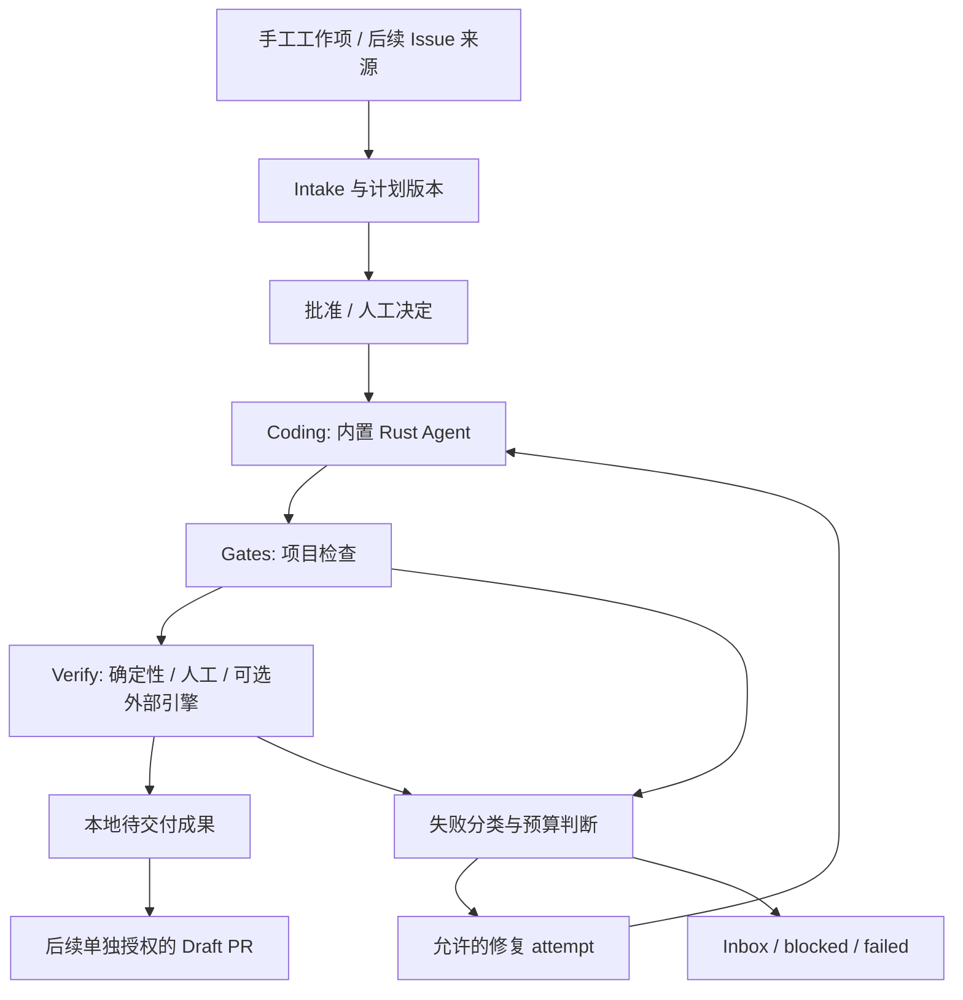

# CodeWave 工程编排与下一步开发方案

> 规划日期：2026-10-15。状态：**开发建议，未实施，业务实现待后续批准**。本次交付包含调研归纳、方案和文档导航；文档分支为 `docs/agent-workflow-roadmap`。按用户要求，本文仅维护 CodeWave 自身规划，不记录竞品名称、品牌介绍或对比表。

## 1. 建议与交付范围

建议 CodeWave 在自有 Rust Agent 之上增加**持久工程工作项与受宿主管理的研发流程**。用户交给应用一项需求，应用负责保存目标、组织阶段、等待决策、执行检查、依据失败证据有限修复，最后提供可审查成果。普通聊天继续保留，工程工作项是显式入口。

第一阶段做“手工创建工作项 → 分析/批准 → 编码 → 门禁/验收 → 本地待交付成果”的单 Loop，并提供最小 Inbox。第二阶段完善失败决策与有限修复。第三阶段接入只读 GitHub Issue 来源，再在独立授权下支持 Draft PR。Graph、多执行器、worktree 和远程工作台留到有稳定单 Loop 和真实需求后推进。首个版本必须交付完整工程目标推进路径，检查与验证是其中的阶段。

方案依据现行源码、外部公开资料与官方技术文档归纳。未执行外部安装脚本、调用真实账户或实测恢复/成本/成功率。CodeWave 源码基线为 [`57db57fc87c76ed2b752b04a1391fcb8bff033fe`](https://github.com/Yangshifu1024/CodeWave/commit/57db57fc87c76ed2b752b04a1391fcb8bff033fe)。本文的新类型、目录、接口、工期与效果目标均是建议，不能当成已经交付的能力。

## 2. 产品结构与核心价值

### 2.1 工作项是中心，对话承载阶段协作

CodeWave 应分别建模 Project、WorkItem、WorkflowRun、StageAttempt、Session 与 Attention：项目负责目录归属，工作项保存需求，流程执行保存推进状态，阶段尝试保存具体输入/结果，会话保存对话，待处理项保存人工决定。用户能从一个需求查到计划、执行过程、失败原因和最终成果。

保留左侧项目/会话入口、顶栏 Tab 与 antd 样式；在项目下增加“工程工作项”，工作项详情显示阶段、成果和验收记录，并链接现有会话、子代理抽屉和 ChangesModal。普通聊天仍可直接使用，不要求为问答创建工作项。

### 2.2 Rust 宿主拥有推进、恢复与交付规则

单 Loop 组织分析、编码、门禁、验证和交付，多 Loop 后续通过 Graph 表达依赖。Rust 状态机决定下一阶段、授权范围和终止条件；模型提供分析、代码和建议。恢复、等待、重试与轮次上限属于宿主规则。模型说完成、run 正常结束、todos 勾选都不足以证明工作项验收通过。

### 2.3 验证按需求选择执行面

首版采用项目已有命令、确定性检查和人工验收，不强制安装外部验证引擎，不要求所有需求都经过 Deploy。代码变更、文档、配置与界面各自有适用的检查清单；本地预览和部署准备按需执行。工具退出码、结构化断言和人工结论分别记录。

### 2.4 外部输入不自动获得执行权

首次接入仅列出/导入用户选中的 Issue，保存来源、外部 ID 和更新时间；外部文本是需求材料，不能当作系统指令或免审批许可。轮询、Webhook、自动领取和交付分别配置，避免把“连接账户”扩大解释为自动修改全部仓库。凭据和投递操作由宿主掌管，不送进模型上下文或 shell 参数。

### 2.5 远程客户端控制实际执行主机

先做好本地快照与带身份的命令接口，让未来远程客户端消费同一控制面。文件、凭据、Agent 与进程归执行主机，客户端仅查看或提交获授权的命令。首版不增加账户、云中继或手机客户端；若后续确需远程访问，应另设计实例认证、连接撤销、设备权限、询问回执和暴露内容范围。仅桌面在线的执行形态不能承诺应用退出或主机休眠后继续运行。

## 3. 能力路线与取舍

| 能力 | 优先完成的产品结果 | 暂缓范围 |
|---|---|---|
| 工程工作项 | 目标、计划、阶段、对话、证据和成果可追踪 | 将全部普通聊天改成任务流程 |
| 耐久单 Loop | 中断点可解释，已确认结果可复用，未知副作用须对账 | 自动从任意工具执行位置继续 |
| Inbox | 集中处理批准、补充需求、环境阻塞、人工验收 | 仅堆叠通知而没有可回答的决策身份 |
| 失败修复 | 在批准范围与预算内依据证据重新编码、验证 | 无限自动重试、自动降低验收标准 |
| 任务来源 | 显式导入、去重、归属与排队 | 连接账户后默认自动接单 |
| 成果交付 | 本地审查包；后续授权 Draft PR | 自动 merge、生产部署和对外发送 |
| Graph | 可校验依赖、产物传递与集成验证 | 首版图形编辑器、共享目录无约束并行 |
| 远程/后台 | 复用控制面、明确 owner 与可用性 | 直接暴露桌面 IPC、未实现后台执行就承诺持续在线 |

## 4. CodeWave 现状与差距

| 能力面 | 当前可复用事实 | 需要补齐的能力 |
|---|---|---|
| 自有 Agent | 参数化主循环、三协议 BYOK、模型和工具执行；[drive.rs](../src-tauri/src/core/agent/drive.rs) | 上层阶段执行器契约；首版使用内置 Agent，外部 coding agent 后置 |
| 需求/批准 | prompt 内标准研发流程、todos、三选项批准、固定预览；[计划与审批](./plan-and-approval.md) | 持久工作项、不可混淆的计划版本与阶段回执；prompt 流程不是耐久 workflow |
| 会话/恢复 | 完整分段历史、元数据快照、工具出参备份；[会话与项目](./sessions-and-projects.md) | 工作项阶段和 attempt 的恢复；恢复聊天不代表恢复在途副作用 |
| 观察/决策 | 进程内 ActivitySnapshot、真实 responder 回跳；[activity.rs](../src-tauri/src/core/activity.rs)、[运行总览](./runtime-and-scheduling.md#5-运行总览) | 工作项级 Attention/Inbox；现有总览不能充当持久任务库 |
| 委派 | 内置角色、文件认领、根权限继承、预算和终态；[子代理](./subagents.md) | 阶段成果校验；预算 partial 和失败不能当阶段成功；没有子 run 暂停续跑协议 |
| 自动执行 | 计划任务已有认领落盘、active_run、中断后不自动重放；[计划任务](./runtime-and-scheduling.md#7-计划任务)、[scheduler.rs](../src-tauri/src/core/scheduler.rs) | 工程工作项调度；当前 scheduled_task 是独立 FullAccess runtime，工具集排除 ask/subagent/MCP，不能直接作为 Loop 执行器 |
| 验收 | `data.check/checks` 写入后检查、command 与人工门禁；[postcheck.rs](../src-tauri/src/tools/postcheck.rs) | 计划级 required checks、输入指纹、持久结果和待交付判据；现有逐次写后检查保持独立 |
| Git/成果 | 只读 git2、workspace diff；[git/mod.rs](../src-tauri/src/git/mod.rs)、[ChangesModal](../ui/src/features/workspace/ChangesModal.tsx) | 本地交付摘要；Draft PR/commit/push 需未来单独授权接口 |
| 扩展 | MCP stdio/streamable-http 与技能；[MCP 与技能](./mcp-and-skills.md) | 可选验证适配器；MCP 不替代权限和恢复策略 |

ACP 现有方案是 **CodeWave 作为 Agent 对接外部 Client**，且尚待批准；不是已实现的出站 coding-agent 编排。入站 ACP、多进程协调与本方案的 desktop workflow 应分别验收，首版不以 ACP 落地为前提。[ACP 接入方案](./acp-integration.md)。

## 5. 目标用户、用户故事与 MVP

初始假设：服务单机个人开发者和小型维护团队，主要操作本地 Git 项目；实施人员为 1 名熟悉本仓库的开发者，拥有人工 review 支持。不假设已有云平台、外部账号或大规模任务量。

| 编号 | 优先级 | 用户故事 | 验收标准 |
|---|---|---|---|
| W01 | P0 | 我将一个需求交给工作项，希望换 Tab/重启后仍知道目标和进展 | 独立 work item ID、目标、AC、project/session 关联；重启后已完成结果保留，在途阶段标中断，不能显示成功 |
| W02 | P0 | 我希望流程自动推进已经授权的步骤，在需要决定时找我 | 宿主验证阶段输出再推进；计划变化需复核；权限不由阶段名提升；普通聊天不强制进入流程 |
| W03 | P0 | 我希望知道哪项检查阻止交付 | required/optional、实际结果、输出路径、输入身份均可见；required 未执行、失败、过期、人工待验都阻止“待交付”；optional 失败如实保留 |
| W04 | P0 | 我希望一个 Inbox 找到待处理决定，并回到正确上下文 | 按工作项/attempt/decision 身份校验；重复回答幂等，过期回答拒绝；重启不复活旧 responder |
| W05 | P1 | 我希望 Agent 按失败证据有限修复，而不是无限尝试 | 用户明确启用；轮次/时间/token/范围预算生效；外部环境故障停为 blocked；取消后不再启动下一 attempt |
| W06 | P2 | 我希望导入指定仓库的 Issue，避免重复录入需求 | 本地项目映射、显式选择、source key 去重；编辑 Issue 保存新来源版本；连接仓库不自动领取全部 Issue |
| W07 | P2 | 我希望审查通过后便捷生成 Draft PR | 精确分支/remote/diff/权限范围预览；commit/push/PR 单独授权；无自动 merge；结果不确定时先对账，不盲重试 |
| W08 | 后续 | 我希望多项独立工作按依赖推进，并远程处理待办 | 单 Loop 稳定后另批 Graph/worktree/Remote UI；按项目快照、执行根和权限隔离，不直接共享写目录并发 |

MVP 包括 W01–W04：手工入口、持久单 Loop、已有 Agent 执行、计划批准、最小 Inbox、检查证据和本地交付包。首版 Inbox 覆盖批准、人工验收和中断复核；自动修复与更丰富的失败决策是下一次增量。GitHub 自动接单、部署到生产、飞书发送、远程控制、多 provider CLI 和 Graph 编辑器不是首版内容。

排序依据为依赖关系与误报/重复副作用风险：持久身份是 Inbox 和恢复的前提，检查证据是修复输入，单 Loop 是任务来源和 Graph 的前提。没有用户规模与使用频次数据，不编造 RICE 分数或收益百分比。

## 6. 产品交互与正常路径

1. 在现有项目入口创建“工程工作项”，填写目标、AC、约束；可关联现有会话。临时聊天需要先选定项目才能转为可执行工作项，不能猜目录。
2. Intake 调用 product-manager/tester 等既有角色辅助分析；形成版本化计划、文件范围和检查清单。用户通过现有批准门选择权限，绑定当前计划版本。
3. Coding 复用 Agent 主循环；模型报告完成后，宿主核对阶段回执、未完成项和运行终态，再进入 Gates。
4. Gates 按批准的清单执行。Verify 根据计划类型执行确定性检查、用户人工验收或显式启用的外部引擎；不需要部署的任务记录“部署不适用”，不能写“部署成功”。
5. 失败进入待处理状态；启用有限修复时生成新的 Coding attempt，附相关错误证据，修改后使旧证据失效并重新验证。
6. 全部 required 项在当前输入版本下完成，生成“待交付”：计划/AC、diff、检查结果、人工结论、未完成与风险。默认交付包只保存在本地，用户操作 Git；后续授权 Draft PR 另走 Delivery。

项目下工作项与会话有独立图标/文案。详情使用 antd Steps/Timeline、列表与现有弹框，不新增自绘彩色流程画布；中性强调色、风险橙/红及三槽字体 token 继续生效。Inbox 是项目/全局待处理入口，普通问答仍使用原 AskPanel；左侧导航仍是一切项目与会话入口。

## 7. 技术方案：在 Agent 之上增加工作流层

以下类型、目录与 IPC 名均为**拟新增设计**，不是当前契约。建议新建 `core/workflows/`，与 `core/agent/`、`core/scheduler.rs` 分离，不将流程状态塞进 Provider adapter 或 `TabRunState`。

### 7.1 工作项、流程执行与会话分开建模

| 拟新增实体 | 关键字段与语义 |
|---|---|
| WorkItem | `id/project_id/roots_snapshot/source/title/objective/acceptance_criteria/plan_revision`；代表需求；source 保存外部 ID/version，不保存认证 token |
| WorkflowRun | `id/work_item_id/stage/state/revision/attempts/policy/budget`；代表一次执行；明确区分 session 的 LLM run ID |
| StageAttempt | `id/stage/input_fingerprint/session_id/agent_run_id/intent/receipt/result`；阶段可重复，但每次有独立身份和输入 |
| CheckDefinition / CheckResult | approved command、显式 cwd、timeout、required、结果/退出码/耗时/证据引用/输入指纹；人工检查另有操作者回执 |
| Attention | `id/workflow_run_id/attempt_id/kind/decision_revision/status`；持久的“需要决定”事实，不持久化 channel/responder |
| DeliveryBundle | 当前输入身份、diff 摘要、AC 对照、检查/人工结果、风险、外部投递回执；本地 ready 与 delivered 分开 |

项目仍是名称与单一主目录；WorkItem 的目录快照与关联 `SessionMeta.project_id + roots` 必须一致，恢复不从可变注册表覆盖快照。后续 worktree 只能是显式登记并授权的执行根，需另补生命周期/删除语义。初版每个项目主目录最多一个可写 WorkflowRun；P0 须建立工作流与普通会话共用的项目写租约，覆盖 Coding 及 Gates/Verify 的一致性窗口。活跃普通会话未释放租约时不得启动工作流；工作流持有租约时，新普通会话不得并发启动可写 run。同一 owner 内的子代理仍遵守现有文件认领；只读工具集的对话可继续。租约按 canonical 写根及重叠路径判断，不能仅凭 project ID，否则共享 extra_roots/别名项目会冲突。模式升档与工具 dispatch 同样参与租约校验，不能只在 start 时检查。现有工具文件锁不能替代租约，外部编辑器/进程不受该租约约束，仍以输入指纹变化使结果失效。

### 7.2 状态机与执行权

阶段为 `intake/coding/gates/verify/delivery`；本地 build/preview 属验证准备，外部 Deploy 后续单独增加。状态为 `queued/running/pause_requested/paused/cancel_requested/waiting_human/blocked/interrupted/ready_to_deliver/delivered/failed/cancelled`。阶段与状态分开，不能把所有失败回落成等待，也不能让“没有 pending 事件”推导成功。

宿主按匹配的 workflow/attempt/session/run 身份接纳回执。子代理 `partial`、预算触顶、取消和 error 都不能自动推进阶段。无输出或自然语言“全部完成”只是候选报告；Gates/Verify 依据结构化结果，Delivery 依据授权与实际回执。

复用现有四档权限和三选项批准，不因进入 Coding/Repair/Delivery 自动设 FullAccess。权限来源是当前关联根会话及该计划的有效授权；降低权限即时取消未启动写步骤，并按现有 step 边界传播到在跑子代理。持久化只存授权审计摘要，重启后恢复可执行步骤前须重新核实有效授权；历史高权限、旧 responder 和模型输出都不作为新授权。

不要把工程任务包装成当前 scheduled_task 再执行：其 FullAccess 与排除交互工具的语义不适合此处。未来 scheduler 只负责提交工作流启动意图，后者使用自己的权限和并发规则；既有 cron/every/once 行为不变。

### 7.3 持久化、崩溃与项目删除

建议托管于 `<主目录>/.codewave/workflows/<work_item_id>/`：`state.json` 保存工作项及 runs/attempts/决定，`artifacts/` 保存不可变结果和交付包。每个工作项单写者、版本 CAS；读取校验 ID、所属项目、普通文件及 canonical 路径，拒绝托管目录/记录符号链接。新增配置字段使用 serde default，不引入旧 config schema 迁移。

首版用单一原子替换记录提交阶段状态、执行意图和回执，避免把日志、状态、outbox 分写后误称事务。时间线由记录投影；调试日志不是真值。证据先写入不可变 artifact 并确认持久化，再在记录内引用 hash/路径；中途崩溃可能留下未引用 artifact，可后续清理，不能产生指向未确认文件的成功结果。控制记录限制大小，attempt 历史分页/分卷是后续容量门；首版达到明确上限时停止接纳新 attempt，保留全部已写数据。

| 中断点 | 恢复规则 |
|---|---|
| 执行意图尚未持久化 | 零执行；保存失败明确阻断 |
| 意图已落盘，尚无执行回执 | `interrupted`；不能区分未执行与执行后未记录，默认需人工判断，不自动重放 |
| 有完整结果与有效输入指纹 | 复用已完成阶段，重新核对当前输入/环境；复用不是重新执行 |
| 结果已发生但落盘失败 | 内存提示“未确认保存”，停后续阶段；重启只承认磁盘已确认信息 |
| 外部写入状态未知 | 保留 operation ID，先查询/人工对账；未支持幂等或查询就不自动重试 |

复用 [atomic.rs](../src-tauri/src/util/atomic.rs) 的现有能力，并补文件替换后目录同步失败的区分；不把 rename 成功等同持久化完全确认。对未知副作用采用至少一次意图记录加保守恢复，**不承诺外部 exactly-once**。

项目删除必须先使工作流 generation/写票据失效、取消活跃运行和阻止新认领，再按现有流程处理会话和托管目录；迟到结果不能重建目录。固定锁序在实现阶段明确，与 scheduler 项目协调和 SessionStore `save_lock → index_lock` 配合，不能在持工作项状态锁时等待 runtime/IO。控制记录由宿主 API 修改，普通 Agent 文件工具拒绝直接写 workflows 控制区；命令围栏仍是静态约束，不能据此宣称能阻止所有外部进程篡改。

后续若改用事务存储，执行意图、版本、回执与待执行记录须在同一事务提交，事务内不运行模型、文件或网络副作用。首版不引入第二套常驻运行时，也不把数据库选型当先决条件。

### 7.4 证据、门禁与有界修复

检查清单绑定批准的计划版本，记录命令/显式 cwd/超时/required/环境依赖。首版复用 command 的 shell 执行与 fence/取消/进程树回收；新工作流检查不复制 postcheck 的“用户预配置命令视为授权”例外，模型提出的命令须依当前权限批准。后续若支持 argv 执行，亦需同等权限边界，不借结构化参数绕过 fence。

结果状态区分 `passed/failed/not_run/blocked/interrupted/cancelled/inconclusive/not_applicable`；证据新鲜度另算 `current/stale/unknown`。`ready_to_deliver` 必须同时满足：当前计划已批准、全部 required AC 有覆盖、required checks 的当前结果为 `passed`（或计划预先批准且有理由的 `not_applicable`）、必要人工验收有当前通过回执、没有未解决 blocker。`not_applicable` 必须由批准计划说明原因，不能由失败后的模型自改；required 项不能用“忽略”冒充通过。模型视觉结论与确定性断言分别显示。

输入指纹至少覆盖计划/检查定义、项目及 roots 身份、HEAD、相关 tracked/untracked 文件内容、锁文件和声明的环境/构建产物身份；不能仅用 Git commit，因为工作区未提交改动不会改变 HEAD。检查前后重采样，变化则结果过期；运行测试产生的已声明输出目录不作为代码输入。范围无法确定或依赖不可复现时标 unknown 并要求重新验证，指纹不证明所有外部状态稳定。用户降低 required 或修改 AC 形成新计划版本，重新确认并生成新证据。

门禁记录每条实际命令，而不把 `pnpm prepr` 总退出码直接翻译为所有步骤通过：硬失败后的步骤为未执行，clippy 软失败单独列 warning/failure 与原因，沿用 [testing](./testing.md#开-pr-前的完整门禁) 的口径。写后检查仍维护 `data.check/checks` 现有 wire 契约，不能变更成 workflow 聚合结果。command 临时 spill 会清理，必要证据须导入工作流 artifact，不能只保存短期路径。

Repair 默认关闭，用户可对当前计划启用，例如最多 2 次修复尝试、30 分钟累计活跃执行时间和明确 token 上限；人工等待另按可选整体截止时间控制。数值是初始待验证配置建议，不是性能承诺。首次 Coding 不计修复次数；每次修复前持久化预算认领，不能重启归零。模型调用、command/MCP 等等待都必须响应取消/剩余时间。未知工具无法按时回收时停到 blocked，不能只停止 UI 计时。

只对可定位的代码/测试失败修复；缺依赖、凭据错误、设备离线、权限拒绝先进入 Inbox/blocked，不重复让 Agent 改代码。禁止自行降低验收标准、删除失败测试或扩大目录范围。相同失败签名连续出现时提前停止；达到任一预算上限保留部分成果、失败证据和下一步建议。

### 7.5 Inbox、快照与界面契约

拟新增薄 IPC：创建/读取工作项、启动/取消/恢复 workflow、取得快照、提交当前 decision；调用一律走 `ipc/client.ts`。`ui/src/stores/workflows.ts` 只是后端投影，按 revision/attempt 拒收迟到结果；先用可见时单飞快照刷新，不增加或改名现有 29 个 handler 键。

Attention 可记录计划复核、预算耗尽、环境缺失、中断未知操作、人工验收和交付授权。活跃 ask 复用 ActivitySnapshot 的身份核对和 AskPanel；重启后的持久 Attention 没有旧 responder，用户恢复时由宿主生成新决策身份，不能把旧 `ask_id` 直接注入前端。过期批准、重复点击、切项目后的迟到回答都拒绝改变其它 attempt。

### 7.6 从单 Loop 到任务来源、Graph 和长期运行

任务接入先提供只读来源适配器：`provider/repository/external_id/revision` 组成来源身份，同一 revision 的重复投递不新建工作项。Issue 更新形成修订候选，运行中不替换已批准目标；关闭 Issue 不自动删除工作项。首版离线恢复只同步候选，不补跑旧事件。后续自动接纳须用户显式配置项目、来源筛选、权限上限、每日预算与并发；队列以工作项认领为边界，暂停先提交则零新执行。

Graph 首版只支持经过批准的 DAG 与节点产物依赖，不做任意节点脚本编辑器：拒绝环、缺失节点和重复 ID；依赖成功且产物身份匹配才认领节点；失败阻塞下游，取消传播规则在启动前可见。共享主目录的写节点默认串行；明确 worktree 或独立执行根的生命周期与权限后才允许写并行。集成节点必须验证组合后的结果，不能把各节点通过拼成全局通过。更改依赖或产物使下游证据失效。

长期运行分两步：先在桌面进程在线期间推进队列，明确退出/休眠即无法继续；后续如需专用机器或后台服务，提取共享 Rust bootstrap/单写 owner 与跨进程协调，参照 ACP 方案的存储协调但独立验收。Remote UI 仅调用执行主机控制面，采用能力协商、短期凭据、撤销与带 decision revision 的应答；不把模型 Key 交给手机、不默认监听公网。此前不能宣传“关机仍跑”或“7×24 无人值守”。

### 7.7 接入现有主循环与结构化阶段结果

工作流执行器通过统一 adapter 调用已有主循环，不复制 LLM、tool batch、压缩、steer 与终态逻辑。一个工作项默认拥有一个用户可见主会话，各阶段/修复以新的 Agent run 执行并记录映射；不在一个正在运行的 run 中偷偷换阶段。系统提示可增加阶段上下文，但宿主状态机才有推进权；输入构建含批准计划版本、AC、允许文件范围、前阶段成果和必要错误证据，不能把全部历史和日志无限拼入。

阶段结果至少包含 `attempt_id/plan_revision/status/completed_criteria/pending_criteria/artifact_refs/failure_kind`，`status` 限 `completed/partial/blocked/failed`。`completed_criteria` 只是模型报告，由宿主逐项核对计划和结果；遗漏、未知 AC、重复 ID、错 attempt、无法解析均不能进入下一阶段。模型以受限的结构化工具参数提交候选报告，工具校验后生成阶段回执，由 adapter 接纳；该工具只能提交报告，不能改变权限、改计划或自行触发 Delivery。

现有 G2 分析与 G3 todos/基线门保持：新增 WorkItem 不自动满足 G2/G3，新 workflow executor 也不绕过批准门。Intake 成果只提供既有门所需分析，用户批准后才绑定对应计划基线。避免 prompt 再次启动完整研发流水线与宿主重复派发；P0 要用真实调用点验证阶段上下文和既有流程提示如何配合，而不只测试 reducer。

对普通 steer 作明确区分：补充背景可继续注入当前 run；改变 AC、文件范围、检查清单或交付目标则记录计划修订候选，先暂停新阶段/写步骤、处理正在执行的操作并请求复核。用户的“继续”不能自动表示批准一个未展示的新计划。模型切换作用于下一 run；旧检查引用原工具链和模型身份，不能覆盖历史结果。

### 7.8 暂停、取消、重试与等待的区别

| 用户动作 / 情况 | 宿主行为 | 恢复前提 |
|---|---|---|
| 暂停 | 原子阻止新阶段/attempt，进入 `pause_requested`；当前原子操作收尾后 `paused`，可见仍在收尾的操作 | 有效计划/权限、当前输入身份、无未知副作用 |
| 立即停止 | `cancel_requested`，向 Agent/子代理/命令传播取消；完成进程回收和结果结算后 `cancelled` | 重新执行创建新的 run/attempt，不复用旧取消票据 |
| 应用异常退出 | 已确认结果保留，活跃 attempt 标 `interrupted`；恢复不猜成 paused 或 completed | 判断是否已执行，必要时人工对账；不声称从工具内部程序计数器续跑 |
| 可重试读取失败 | 在持久剩余预算内退避，使用新 attempt；原身份保留 | 明确无写副作用、授权/endpoint 不变 |
| 写结果未知 | `blocked` 并生成 Attention，保留 operation ID | 查询真实结果或用户确认后才决定是否新执行 |
| 等待人工 | 持久化 Attention 并释放 LLM/工具 worker 容量；不丢失决策内容 | 当前 decision revision 的有效回答；旧回答不重放 |

暂停不是回滚，也不是立刻杀进程；取消不撤销已写文件或远端操作。进程回收失败维持明确的 `blocked` 与残留诊断，不能过早标 cancelled。人工等待默认无超时自动批准；现有 ask 的 `auto_confirm` 契约仍按其原用途处理，新恢复、变更计划和 Delivery 决策不继承自动确认。

需要区分总执行时间与人工等待：执行预算记录累计活跃时间，人工等待不消耗该预算；另有用户可选的整体截止时间。进程内计时使用单调时钟，持久化累计耗时与墙钟时间；崩溃前未结算的区间按保守上界计入，时钟回拨不得补回预算。实际 tool/MCP timeout 取其原上限与剩余阶段预算的较小值，heartbeat/进度信号不能无限延长总上限。

等待人工、paused 或 blocked 且所有操作已结算后释放写租约，避免一个待办长期锁住项目；继续时重新取得租约、重验权限和输入指纹，必要时使 Gates/Verify 证据过期并重跑。仍有未回收进程或未知在途写操作时不能提前释放；向用户展示实际阻塞原因和人工处理入口。

### 7.9 存储与执行架构的选型门

| 方案 | 适用范围 | 代价与约束 | 本轮建议 |
|---|---|---|---|
| 现有原子文件 + 单写者 | 桌面单进程、少量工作项、单 Loop | 工作项记录大小有界；没有跨文件事务；须处理 directory sync、CAS 和损坏隔离 | P0 原型及首个最小版本优先复用，不增加运行时服务 |
| 项目内 SQLite 事务存储 | 多工作项查询、长期 attempt/Inbox/来源去重、后续多进程 owner | 新依赖、事务/锁/备份与一致性验证；artifacts 仍在数据库外；不能将 WAL 当任意网络盘支持 | P0 压测后决策；若文件模型超过容量/延迟目标，先批准该替代方案再实施 |
| 独立常驻服务或云调度 | 桌面退出后持续执行、多主机和远程客户端 | 生命周期、认证、部署、共享数据锁和额外运维 | 首版暂缓；不为了单 Loop 新增 Node/Python 编排 sidecar |

SQLite 文档说明 WAL 要求参与进程位于同一主机，且事务提交与断电耐久性取决于同步配置等因素；因此项目位于网络盘时不能直接套用同一方案，也不能把启用 WAL 写成“永不丢数据”。如果选择事务存储，须固定同步/锁策略、断电模拟、checkpoint 和一致备份方法。[WAL 官方说明](https://sqlite.org/wal.html)、[原子提交说明](https://sqlite.org/atomiccommit.html)。

P0 建议使用小/大 fixture 比较 10/100/1000 个工作项、20/200 个 attempts，记录快照/Inbox 查询 p95、写入/重启恢复耗时、峰值内存和 artifact 体积。规模是测试样本，不是支持承诺。先按现有原子文件路径做原型；若必须事务存储则在 P0 结论中更新文件清单、依赖与工期，避免 P1 同时维护两种可写后端。记录显式 `format_version`，未知新格式拒绝执行并允许只读导出，不新增旧版配置迁移或隐式数据格式重建。

### 7.10 来源接入、交付对账与可观察性

桌面首版 GitHub 来源采用显式同步或低频条件请求，保存 ETag/Last-Modified、同步游标和错误状态；限流时遵循 Retry-After/reset 信息并退避，不持续重试。官方建议优先 webhook，在必须轮询时减少请求并使用条件请求；这里因首版不暴露接收端而选择轮询，是明确的工程取舍。[REST API 最佳实践](https://docs.github.com/en/rest/using-the-rest-api/best-practices-for-using-the-rest-api)。

后续接收 webhook 时先对原始请求体验证 `X-Hub-Signature-256`、校验 event/action 和大小上限，再持久化收件记录，快速应答后异步规范化；不在 HTTP 回调中执行 Agent。官方说明同一事件重投的 `X-GitHub-Delivery` 保持不变，需同时进行投递 ID 去重和业务来源 ID/version 去重。签名只证明来源与完整性，不证明 Issue 正文具有执行授权。[签名校验](https://docs.github.com/en/webhooks/using-webhooks/validating-webhook-deliveries)、[Webhook 最佳实践](https://docs.github.com/en/webhooks/using-webhooks/best-practices-for-using-webhooks)。

Draft PR 拟分为准备成果 → 展示授权 → 分支/commit → push → 创建/更新 PR → 保存投递回执，各动作有独立 operation ID 与输入身份。批准绑定仓库、remote、基线/分支、diff 指纹及具体写动作；任一变化使旧批准失效。托管目录和敏感数据不自动加入提交，已有用户改动不能混入。无法证明是哪次操作形成的 commit/远端分支/PR 时先停止对账；禁止用强推、reset、删除分支来“补偿”。默认无自动 merge；复核只读 Git 真值，不把 Agent 的文字输出当实际投递回执。

修改命令使用客户端 `request_id` 加 payload 指纹去重，同 ID 同意图返回原回执，同 ID 不同 payload 拒绝；“已经接纳”只说明意图落盘，不说明执行成功。外部操作若支持幂等键则复用稳定 key，未知效果不凭 HTTP 错误码或方法名猜测可重试。该规则参考幂等 API 的请求身份与晚到请求讨论，并按本地恢复边界取保守策略。[幂等 API 技术参考](https://aws.amazon.com/builders-library/making-retries-safe-with-idempotent-APIs/)、[HTTP 幂等语义](https://www.rfc-editor.org/rfc/rfc9110.html#section-9.2.2)。

本地日志用 `work_item_id/workflow_run_id/attempt_id/agent_run_id/decision_id/operation_id` 串联；timeline 展示接纳、执行、等待、检查、取消与保存失败。仅记录必要摘要，认证头/钥匙串引用解析值不入日志，失败正文和截图按用户导出时明确选择。默认不上传遥测；导出诊断需保留脱敏及原文敏感提示，HTML/截图/外部报告按已有预览边界处理，不为查看证据放宽 WebView CSP。

远程增量必须提供带 revision 的快照与断线重订阅；读/回答/执行/投递分开授权。WebSocket 握手的 Origin 可辅助限制浏览器来源，但协议并不替应用完成认证，不能将有连接等同可调用所有命令。[WebSocket 协议](https://www.rfc-editor.org/rfc/rfc6455.html#section-10.2)。

## 8. 分阶段开发与文件级拆分

工期按 1 名熟悉 Rust/Tauri/React 的开发者和人工 review 估算，仅供排期；需在 P0 验证后重估。每阶段独立授权、分支和验收，不因本次文档 push 获得后续业务实现或对外写入授权。

| 阶段 | 建议范围 / 分支 | 预计工作量 | 拟改动位置与完成门 |
|---|---|---|---|
| P0 模型与恢复原型 | 固定工作项/阶段/权限/结果契约；`feat/workflow-foundation` | 3–5 工作日 | 新 `core/workflows/{types,store,state_machine,tests}`、`core/mod.rs`、必要的 project 删除协调；以 fake executor 覆盖中断/迟到/保存失败，不接真实外部服务 |
| P1 可用单 Loop 与 Inbox | W01–W04；`feat/engineering-work-items` | 2–3 周 | 新 workflow runner/checks/attention、agent 阶段适配、`host/commands/workflows`、`lib.rs`、IPC types/client、workflows store、shell/panels 工作项与最小 Inbox；手工工作项到本地成果完整闭环，普通聊天回归 |
| P2 失败决策与修复 | W05 与 Inbox 增量；`feat/workflow-inbox-repair` | 1–2 周 | 新 budget/repair、失败分类与 UI；持久预算、有限修复、取消收敛；不把 scheduled_task 改成另一种权限 |
| P3 外部接入与 Draft PR | W06–W07；`feat/workflow-github-intake` 与独立 delivery 分支 | 2–3 周 | 新 source/delivery adapter、凭据宿主接口、仓库映射、授权预览与投递回执；先只读 Issue 导入，再用户批准最小 Git 写能力；不在现有只读 git 模块暗增写 API |
| P4 按需求扩展 | Graph/worktree/外部执行器/Remote UI | 单独评估 | 依赖隔离与多进程协调先验；重新设计权限、执行根、实例认证与协议验收，不能以单 Loop 测试替代 |

依赖顺序 P0 → P1 → P2；P3 的只读来源可在 P1 稳定后开展，但自动执行与交付依赖 P2 的决策/恢复语义。首个可用闭环约 3–4 周，推进到外部任务/交付约 7–10 周；包含跨层测试、审查与真机验收，不是承诺发布日期。预算不足时止于 P1，本地成果已可使用。

建议实现阶段登记如下 todos，全部尚未完成：

- [ ] P0 固定数据模型、状态转移、输入身份、锁序、容量和恢复决策，并跑故障注入原型。
- [ ] P1 实现持久手工工作项、内置 Agent 单 Loop、批准/检查/本地成果、最小 Inbox 与失效决策回执。
- [ ] P2 完善失败决策、持久预算、修复和整条链路取消。
- [ ] P3 先完成只读 Issue 导入；另行批准 Git 写、Draft PR、凭据与未知投递对账。
- [ ] 每阶段调用 code-reviewer 七维审查，修复严重问题；完成相关后端/前端测试，PR 前完整 `pnpm prepr`。
- [ ] 每阶段由用户执行 GUI 人工清单；将已生效契约回写对应长期主题。

## 9. 验证、指标与回退

| 验证面 | 必须覆盖的场景 |
|---|---|
| 状态机 | 合法/非法跳转、旧 attempt 回执、空报告、partial、required 未执行、软失败、证据过期、AC 改版、重复回答 |
| 存储与恢复 | 意图前/后/副作用后/回执前崩溃、原子替换和目录同步故障、损坏/超容量记录、离线目录、symlink、并发 CAS、重复启动、项目删除与迟到写 |
| 权限/取消 | 四档及降档、预览不批准、恢复不继承旧高权限、MCP 不自动 always_allow、超预算停新 attempt、command/子代理取消回收 |
| 执行/证据 | cwd 为批准的代码主目录、空格/Unicode 路径、未提交和 untracked 输入变化、锁文件/构建产物变化、输出截断导入、检查进程超时、环境故障分类 |
| 交付/来源 | Issue 去重与更新、不可信内容、项目映射错误、撤销授权、remote/branch 变化、Draft PR 已成功但回执丢失、无自动 merge |
| 前端契约 | 工作项与会话 ID 分离、快照/事件乱序、切 Tab/项目、关闭详情后继续运行、Inbox 过期/重复回应、普通聊天和队列回归 |

改后端在 `src-tauri/` 跑 `cargo test --workspace`；改前端在根跑 `pnpm --dir ui test` 与 `pnpm --dir ui build`；跨层两边都跑。开 PR 前完整 `pnpm prepr`，命令/目录/平台/退出码及未执行项按 [testing](./testing.md) 报告。三平台 CI、故障注入和 GUI 实机分别记录。

界面不做自动点验，由用户按以下步骤人工验收：创建工作项并批准；Coding 中切 Tab、关闭详情/重开；Gates 失败后启用一次修复；等待人工验收时重启应用；确认新决策回执只影响当前 attempt；修改代码后旧通过结果失效；取消与项目删除不残留写入；检查中英、亮暗主题、窄窗口与长计划。只验证待改应用的外部引擎不自动获得本仓 GUI 点验授权。

指标先用本地 fixture 和志愿用户记录建立基线，不增加遥测：重启后工作项/证据一致性、未知副作用自动重放次数（目标 0）、required 缺失却标 ready 次数（目标 0）、取消后新 attempt 次数（目标 0）、首个闭环所需人工步骤、修复次数和接管原因。成功率/成本提升待真实样本后决定，不能引用竞品营销跑分作为验收。

每阶段使用功能开关，默认用户显式创建工作项后才接管流程；关闭开关停止新认领，不中断已有数据读取。回退保留工作项和 artifacts，不自动删除、reset、stash 或改写用户代码。损坏记录隔离并提示；旧二进制不理解的工作项只读保留，先停止执行后回退，不设计隐式旧版本迁移。

## 10. 待决策事项与文档维护

实施 P0 前需确定：首批用户项目类型及 gates 时长；每个工作项的 AC/人工验收口径；同目录普通会话的写入互斥策略；token/墙钟预算和 artifact 保留上限；是否需要外部 coding agent；GitHub 最小授权与远程访问是否真的必要。暂无数据支持直接做 Graph、云调度或全量插件市场。

尚未验证本方案的恢复性能、完整权限协作、Graph 并行收益、真实修复成功率、外部验证适配和后台服务形态；这些需要原型、故障注入与实机数据。不存在可沿用的外部性能承诺；不得将搜索所得设计思路写成 CodeWave 已具备的能力。

本主题独立的原因是新增工作项、耐久阶段、决策、来源和交付控制横跨会话、调度、权限、MCP 与界面，现有指南维护现行行为，不能单篇完整承载尚未批准的产品/架构方案。新增后 docs 为 18 篇（14 篇长期指南、3 篇待批准或验收专项方案、索引），仍在 20 篇维护目标内。

后续有效契约分别由 [运行与调度](./runtime-and-scheduling.md)、[会话与项目](./sessions-and-projects.md)、[计划与审批](./plan-and-approval.md)、[工具与安全](./tools-and-safety.md)、[聊天与界面](./chat-and-interface.md) 主维护。本主题实施后原位转为工程工作流指南，删除完成的排期/todos 和一次性验证报告，保留产品定位、架构取舍、仍未完成的能力与互操作矩阵；不另建归档副本。
